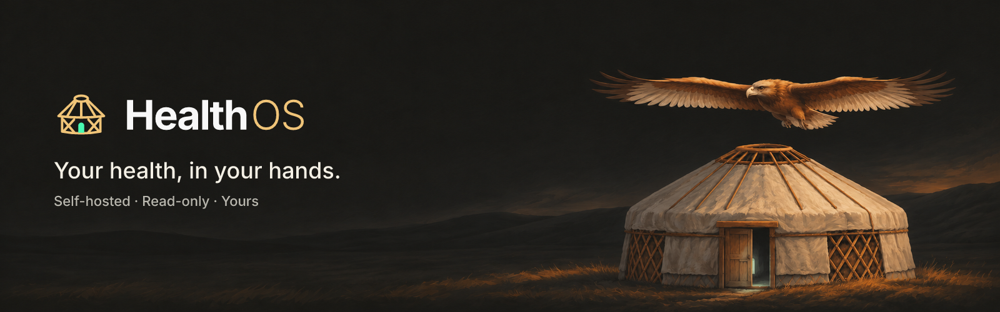
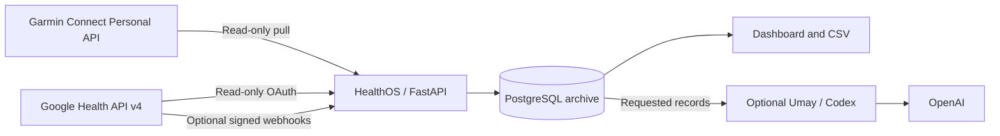

<div align="center">



<p><strong>A self-hosted, read-only archive of your own health data, with a calm dashboard on top.</strong></p>

[](https://github.com/M3rgen/HealthOS/actions/workflows/ci.yml)
[](https://github.com/M3rgen/HealthOS/releases/tag/v0.2.2)
[](LICENSE)


[What it does](#what-it-does) · [Preview](#a-closer-look) · [Get started](#get-started) · [Install guide](docs/INSTALL.md) · [Privacy](#privacy-and-scope) · [Documentation](#documentation) · [Changelog](CHANGELOG.md)

</div>

---

> **Türkçe kurulum:** Kurulum sihirbazı Türkçe de konuşur. Adım adım Türkçe rehber: [docs/INSTALL.tr.md](docs/INSTALL.tr.md).

HealthOS copies your health and fitness records from your wearables' services into a PostgreSQL database you operate. It keeps the original payloads before anything is normalized, shows daily movement, sleep, heart rate, HRV and oxygen saturation in a single-screen dashboard, and lets you export your history whenever you want. An optional companion, **Umay**, can help you read the archive through a separate Codex conversation.

The archive and dashboard need no AI subscription. HealthOS is a personal, single-user application, not a hosted or multi-user service, and it is not a medical device ([Privacy and scope](#privacy-and-scope)).

**What you can connect.** Every source is optional, and several can run side by side (`HEALTHOS_SOURCES`). What each value does is on [Sources](docs/reference/sources.md#sources).

| Source | Status | What you need |
| --- | --- | --- |
| **Garmin Connect** (Personal API) | **Start here.** Included; you create the key yourself. | A Personal API key from your Garmin Connect account, created on [Garmin's Personal API page](https://developer.garmin.com/gc-developer-program/personal/personal-api) and kept in a file ([Connect Garmin](#3-connect-garmin)). |
| **Google Health API v4** (Fitbit, Pixel Watch) | Included, but usable only with an already approved project: Google says it has not been onboarding new Google Health API projects since October 3, 2026. | An eligible Google Cloud project with API access and a linked Google Health account ([setup](#4-connect-google-health)). |
| **Apple Health** (Apple Watch, iPhone) | **Included in the published release** as an extension (this checkout has `app/apple/`). A tree without it starts cleanly with `HEALTHOS_SOURCES=apple` and imports nothing ([details](docs/reference/sources.md#what-is-not-in-this-tree)). | The Health app's `export.zip`; for automatic uploads, the Health Auto Export app ([Apple Health](#optional-apple-watch--apple-health)). |
| **None selected** | The default in `.env.example`. | An empty dashboard, manual entries, the automated tests, and the optional synthetic sample data (`healthos demo`). |

**What you actually get with each one.**

- **Nothing connected:** an empty dashboard, or a synthetic 90-day sample set if you choose **Try with sample data** (also `healthos demo`; remove it with `healthos demo --remove`). Beyond that, the only records are measurements and workouts you type in yourself. See [Sample data](docs/reference/sources.md#sample-data-örnek-veri).
- **Garmin:** the realistic way to get data as a new user. Steps, sleep, resting heart rate, HRV, SpO₂ and workouts from your own Garmin Connect account, pulled every two hours; you need a Garmin device and account. The key expires on the period you choose when you create it.
- **Google Health:** only if you already hold an approved Google Health API project; Google has stopped onboarding new ones, so new users without an approved project cannot use this source (see the [changelog](CHANGELOG.md) for this tree's release context).
- **Apple Health:** upload the Health app's `export.zip` on the System page, or let the Health Auto Export app post your data ([details](#optional-apple-watch--apple-health)).
- **Umay:** optional and separate. It needs **Codex CLI 0.161.0 exactly** and a **ChatGPT login** on the Docker host, and your questions and the records it requests go to OpenAI ([details](#optional-umay)).

**Install:** run the guided installer in [Get started](#get-started) below (it asks in English or Turkish; every option is in the [installation guide](docs/INSTALL.md)), or follow the manual steps there.

> [!NOTE]
> **Language.** Documentation is in English; files named `*.tr.md` are Turkish. The dashboard is Turkish by default and has a working English switch at **Sistem › Görünüm › Dil** (kept in that browser). The login page, Umay's voice and some CLI messages stay Turkish.
>
> **Fitbit Web API shutdown.** Support for the legacy Fitbit Web API ended on September 30, 2026, and the API shut down completely on October 30, 2026. For Fitbit data HealthOS uses only Google Health API v4 (`health.googleapis.com/v4`), Google OAuth and `googlehealth.*` scopes, so it is not affected.

> [!IMPORTANT]
> **API availability.** As of October 3, 2026, Google says new Google Health API projects are not being onboarded. Real synchronization requires an eligible Google Cloud project and a linked Google Health account. Without credentials you can still run the empty dashboard, manual entries and the automated tests. Check the [official setup guide](https://developers.google.com/health/setup) before planning an integration.

## What it does

| Capability | What it gives you |
| --- | --- |
| **Daily overview** | Steps, sleep, resting heart rate, HRV and SpO₂, with hourly charts where records exist. |
| **History and export** | Weekly and monthly views, a draggable history panel and CSV downloads. |
| **Body and workouts** | Manual body measurements and workouts next to archived source records, on one workout timeline. Manual entries can be flagged as test entries without being deleted. |
| **Raw-first storage** | Original payloads and verbatim Google and Garmin responses are kept before normalization; unknown fields stay available, and record versions are preserved rather than overwritten. |
| **Reliable archiving** | Resumable backfills, overlapping incremental sync, signed webhooks, daily reconciliation and persisted checkpoints. |
| **Evidence you can check** | A coverage report per data type and day with retrieval receipts, a reconciliation history of new, changed and source-deleted records, and webhook diagnostics with separate failure counters. |
| **Pages with their own address** | Overview, Measurements, System and Sports have URLs (`#/measurements`, `#/system`, `#/sports`), so Back, Forward and reload keep the page you were on. |
| **Local operations** | Encrypted PostgreSQL backups with a status endpoint, integrity checks, sync status and bounded automatic recovery. |
| **Optional Umay chat** | Read-only archive tools for summaries, personal baselines, sleep, intraday and session structure, and a per-turn receipt of what was sent to the model. |

Missing measurements stay missing; they never become zero. The application only reads from Google and Garmin, and manual entries live separately in your local database.

## A closer look


<table>
<tr>
<td width="50%" valign="top"><br /><sub><b>Umay.</b> The optional chat bubble answers from your archive and shows a per-turn receipt of what was sent.</sub></td>
<td width="50%" valign="top"><br /><sub><b>Metric history.</b> Steps, sleep and resting heart rate in 30-day pages; missing days stay empty.</sub></td>
</tr>
<tr>
<td width="50%" valign="top"><br /><sub><b>Date picker.</b> Open any earlier day from the header; the cards and the seven-day table follow it.</sub></td>
<td width="50%" valign="top"><br /><sub><b>Appearance.</b> Logo, Umay portrait and background presets, or your own image. Presets follow you across devices; uploads stay in the browser.</sub></td>
</tr>
</table>

<sub>Actual application interface, captured with the synthetic preview harness in <code>frontend/preview</code> (desktop 1440×900, mobile 390×844). No personal health records are included. The anatomical model is a generic reference.</sub>

<details>
<summary>See the mobile layout</summary>

<p align="center">&nbsp;</p>

</details>

## Architecture



FastAPI serves the Vite/Three.js frontend. PostgreSQL stores the archive and synchronization state. APScheduler runs reconciliation inside the app, so no separate queue is needed. Docker builds the frontend, so the host does not need Node.js for the Docker setup. The app and database containers run with a read-only root filesystem and `no-new-privileges`.

The layers and their import rules, the data flow of every source, why each source keeps its own raw tables and why the record-identity layer is as large as it is are described in [Architecture](docs/ARCHITECTURE.md).

## Get started

The guided installer sets everything up: it checks Docker, writes `.env` with fresh secrets, configures your data sources, schedules encrypted backups and autostart, and starts the stack. It asks its questions in English or Turkish. **The default target is a Linux server**; the installer also covers Raspberry Pi, NAS, macOS, Windows and cloud VPS.

**Linux, Raspberry Pi, VPS, macOS:**

```sh
curl -fsSL https://raw.githubusercontent.com/M3rgen/HealthOS/v0.2.2.1/install.sh | bash
```

**Windows 10/11** (PowerShell):

```powershell
irm https://raw.githubusercontent.com/M3rgen/HealthOS/v0.2.2.1/install.ps1 | iex
```

These commands install the release v0.2.2.1: the installer clones the tag it comes from.

**The development version** (`main`, not a release; only when you need an unreleased fix):

```sh
curl -fsSL https://raw.githubusercontent.com/M3rgen/HealthOS/main/install.sh | bash -s -- --ref main
```

```powershell
& ([scriptblock]::Create((irm https://raw.githubusercontent.com/M3rgen/HealthOS/main/install.ps1))) -Ref main
```

**Prefer to read before running?** Clone, read the script, then run it from the checkout (`--dry-run` prints every action without doing it):

```sh
git clone --branch v0.2.2.1 https://github.com/M3rgen/HealthOS.git
cd HealthOS
./install.sh --dry-run
./install.sh                 # Windows: powershell -ExecutionPolicy Bypass -File .\install.ps1
```

When it finishes, open **[localhost:8000](http://localhost:8000)** and enter the access token it printed (on a server, through an SSH tunnel). Re-running the installer is safe: it copies `.env` to a dated backup before any change, never replaces an existing secret, never removes a volume and never deletes a backup. A re-run changes only the few `.env` values listed in [what the installer changes](docs/INSTALL.md#what-the-installer-changes-and-what-it-never-does), and it keeps the previous mode (trial or full) unless you pass `--mode`. The default platform is Linux on a Linux host; on macOS or Windows the installer preselects that host's own platform. Every option, the trial and full modes and per-platform details are in the [installation guide](docs/INSTALL.md).

### Install with an AI agent

A coding agent with shell access can do the installation for you by following [AI_INSTALL.md](docs/AI_INSTALL.md). Give it this prompt:

```text
Install HealthOS on this computer by following https://raw.githubusercontent.com/M3rgen/HealthOS/v0.2.2.1/docs/AI_INSTALL.md — ask me before any step that needs admin rights or my accounts, and never delete data.
```

```text
Bu bilgisayara HealthOS'u kur: https://raw.githubusercontent.com/M3rgen/HealthOS/v0.2.2.1/docs/AI_INSTALL.md adımlarını izle; yönetici izni ya da hesap bilgisi gereken her adımdan önce bana sor ve hiçbir veriyi silme.
```

Ready to run in a terminal, with [Claude Code](https://docs.claude.com/en/docs/claude-code/overview) or the OpenAI Codex CLI:

```sh
claude "Install HealthOS on this computer by following https://raw.githubusercontent.com/M3rgen/HealthOS/v0.2.2.1/docs/AI_INSTALL.md — ask me before any step that needs admin rights or my accounts, and never delete data."
codex "Install HealthOS on this computer by following https://raw.githubusercontent.com/M3rgen/HealthOS/v0.2.2.1/docs/AI_INSTALL.md — ask me before any step that needs admin rights or my accounts, and never delete data."
```

Or paste the prompt into Claude Code, Codex or any other agent that can run commands. The agent asks you the same questions as the installer, shows a dry run first, then runs the installer non-interactively with your answers.

### Platforms

| Platform | Requirements | Guide |
| --- | --- | --- |
| **Linux server / VM** (default) | 64-bit Debian, Ubuntu, Fedora or similar (also a Proxmox VM/LXC); Docker Engine with Compose v2; Git; `age` and Python 3.11+ for backups | [Linux](docs/INSTALL.md#linux-server-or-vm-default) |
| **Raspberry Pi / ARM64** | 64-bit OS (32-bit ARM is not supported); 4 GB RAM or more recommended; SSD rather than SD card for the database; slow first build | [Raspberry Pi](docs/INSTALL.md#raspberry-pi-and-other-arm64-boards) |
| **NAS** (Synology, QNAP, Unraid, TrueNAS SCALE) | x86-64 or ARM64 model with a Docker/Compose app and SSH | [NAS](docs/INSTALL.md#nas-synology-qnap-unraid-truenas-scale) |
| **macOS** (Apple Silicon or Intel) | Docker Desktop, OrbStack or Colima; Git; `brew install age` and Python 3.11+ for backups | [macOS](docs/INSTALL.md#macos) |
| **Windows 10/11** | Docker Desktop with WSL 2; Git for Windows; `winget install FiloSottile.age` | [Windows](docs/INSTALL.md#windows-10-and-11) |
| **Cloud VPS** | As Linux; only SSH open to the internet | [Cloud VPS](docs/INSTALL.md#cloud-vps) |

Every platform runs the same Compose files and images (amd64 and arm64). Daily encrypted backups, autostart after a reboot and the optional Umay bridge use the host's own scheduler: systemd on Linux, launchd on macOS, Task Scheduler on Windows. A modern browser with WebGL shows the dashboard. Internet access is needed to build images and to synchronize; Umay also needs access to OpenAI.

### Manual setup

The installer automates the steps below; you can also do them by hand. Details for every step are in the [installation guide](docs/INSTALL.md) and, for a production server, the [deployment guide](docs/DEPLOYMENT.md).

### Requirements

| Setup | Requirements |
| --- | --- |
| **Recommended: Docker** | Git, Docker Engine or Docker Desktop, Docker Compose v2, and a modern browser with WebGL. |
| **Backups** | Python 3.11+ on the host for `make backup` and the backup timer. |
| **Native development** | Python 3.12 or 3.13, `uv` 0.13.6, PostgreSQL, and Node.js 24 for frontend builds. The shipped Compose stack uses PostgreSQL 17. |
| **Garmin** | A Garmin Connect account and a Personal API key. |
| **Google synchronization** | An eligible Google Cloud project, Google Health API access, an OAuth web client, and a linked Google Health account. |
| **Server deployment** | A Linux server (Debian is documented) with Docker Engine; see [Deployment](docs/DEPLOYMENT.md). |
| **Optional webhooks** | A public HTTPS endpoint that forwards only `/webhooks/google-health`; the documented setup uses a Cloudflare Tunnel. |
| **Optional Umay** | Codex CLI 0.161.0 exactly (the bridge refuses other releases) and an authenticated ChatGPT account on the Docker host; the bridge launcher supports Linux, macOS and Windows. |

Internet access is needed to build images and to reach Garmin or Google; Umay also needs access to OpenAI. Storage depends on how much history you archive.

### 1. Clone and configure

```sh
git clone --branch v0.2.2.1 https://github.com/M3rgen/HealthOS.git
cd HealthOS
make env
install -d -m 755 backup-status
```
Create `backup-status` before starting Compose so the host user owns the directory instead of Docker creating it as root.

`make env` generates three secrets in a mode-600 `.env` and refuses to replace an existing file (Python 3.9+). To configure by hand instead, run `cp .env.example .env && chmod 600 .env`, then open `.env` and set three values:

- `POSTGRES_PASSWORD`: a long random value. A hexadecimal password avoids URL-escaping issues in the Compose database URL.
- `POSTGRES_APP_PASSWORD`: the password of the non-superuser role the app connects with (`POSTGRES_APP_USER`, set to `healthos_app` in the template). The schema stays owned by the migration role, so the app cannot disable the append-only triggers. Hexadecimal, like `POSTGRES_PASSWORD`; the template needs this value too, or `provision-app-role` stops and the app does not start.
- `APP_UI_TOKEN`: the access key for the dashboard and API, 32 to 512 printable characters without spaces, and not guessable ([what production refuses](docs/reference/config.md#secret-strength)). You type it once on the login page; scripts send it as `Authorization: Bearer <token>`.

```sh
python3 -c "import secrets; print(secrets.token_hex(32))"        # POSTGRES_PASSWORD, POSTGRES_APP_PASSWORD (run once each)
python3 -c "import secrets; print(secrets.token_urlsafe(32))"    # APP_UI_TOKEN
```

Store the results only in `.env`. `.env` is ignored by Git; `.env.example` contains blank secret fields. The template sets `HEALTHOS_SOURCES=none`, so nothing else is needed to start.

### 2. Start HealthOS

```sh
docker compose up -d --build
docker compose ps
```

Open **[healthos.localhost:8000](http://healthos.localhost:8000)** and enter your `APP_UI_TOKEN`. The session lasts 30 days there or over HTTPS; plain `localhost` and `127.0.0.1` redirect there before showing the login form ([why](docs/UI_AUTH.md#session-lifetime)). The first build downloads dependencies and takes a few minutes; the one-shot `migrate` and `provision-app-role` services apply database migrations and create the app's role before the app starts. You get an empty archive, the dashboard and manual entries, in production mode: the app only refuses to start when a source you selected is missing what it needs.

After logging in, [healthos.localhost:8000/health](http://healthos.localhost:8000/health) shows pipeline status. Interactive API documentation (`/docs`) is off in production; for development, add `-f docker-compose.yml -f docker-compose.dev.yml` (it also publishes PostgreSQL on `127.0.0.1:5432`).

> [!IMPORTANT]
> **Existing installations: migrate before updating.**
> 1. Run `make backup`, then check the current database role ([runbook](docs/RUNBOOK.md#application-database-role)).
> 2. Set `POSTGRES_APP_USER=healthos_app` and a generated `POSTGRES_APP_PASSWORD` in `.env`; remove any owner/privileged role membership before provisioning.
> 3. Validate existing secrets against the [production requirements](docs/DEPLOYMENT.md#3-fill-in-env); if role migration must wait, set `HEALTHOS_ALLOW_SUPERUSER_UNTIL=<YYYY-MM-DD>` at most 30 days ahead, then remove it after migration.
> 4. Build and start (`docker compose build app`, `docker compose up -d`); confirm the app uses `healthos_app` and `/health` has no `database_role_*` reason (temporary grace reports `database_role_superuser_grace`).
> 5. Reopen `healthos.localhost:8000` and log in, keep an explicit existing `GOOGLE_REDIRECT_URI` in `.env` or register the new `http://healthos.localhost:8000/auth/google/callback` default in Google Cloud Console first, and restart the host bridge after the update ([runbook](docs/RUNBOOK.md#restart-the-umay-bridge)).

### 3. Connect Garmin

No approval process is involved: you create the key yourself and it stays in a file on the Docker host. The key mount, ownership check and `garmin-status` were run against the production Compose stack with a synthetic key; step 4 needs a real key.

1. Create a Personal API key on [Garmin's Personal API page](https://developer.garmin.com/gc-developer-program/personal/personal-api): logged in to Garmin Connect, choose **Create Key**, accept the terms, pick an expiry and create it. Garmin shows the key once, so copy it straight away. Save it to a file, then install it for the container's user (UID 10001), readable by that user alone:

   ```sh
   sudo install -d -m 700 -o 10001 -g 10001 /opt/healthos/secrets
   sudo install -m 400 -o 10001 -g 10001 <downloaded-key-file> /opt/healthos/secrets/garmin-personal-api-key
   sudo setpriv --reuid=10001 --regid=10001 --clear-groups test -r /opt/healthos/secrets/garmin-personal-api-key && echo ok
   ```

   `setpriv` is part of util-linux (installed on Debian); it checks access as UID/GID 10001 without requiring a host user account. After configuring Compose below, the Docker equivalent is `docker compose run --rm app healthos garmin-status`: check for `"key_file_present": true` in its output.

2. Add to `.env` (Compose reads `COMPOSE_FILE` from it, so no tracked file changes; `docker-compose.garmin.yml` mounts the key into `app` and `migrate`). Use an absolute `GARMIN_API_KEY_HOST_FILE`:

   ```dotenv
   COMPOSE_FILE=docker-compose.yml:docker-compose.garmin.yml
   HEALTHOS_SOURCES=garmin
   GARMIN_API_KEY_HOST_FILE=/opt/healthos/secrets/garmin-personal-api-key
   ```

3. Apply it and check that the key is found. `garmin-status` makes no request to Garmin:

   ```sh
   docker compose up -d --force-recreate
   docker compose exec app healthos garmin-status   # "enabled": true, "key_file_present": true
   ```

   On a server, `/opt/healthos/secrets` sits inside the checkout: `.gitignore` and `.dockerignore` exclude `secrets`, so the key stays out of Git and out of image builds.

   A mistyped `GARMIN_API_KEY_HOST_FILE` stops `up` with `bind source path does not exist`, naming the path; nothing is created. If `migrate` exits with `unsafe or missing production configuration: GARMIN_API_KEY_FILE`, the file is empty or not readable by UID 10001. Keep the key file owned by UID 10001 after every renewal; on Docker hosts backed by a VM, check `garmin-status` after changing it, because file ownership may be mapped differently there.

4. Pull your first data, then as much history as you want. `--dry-run` only counts the requests:

   ```sh
   docker compose exec app healthos garmin-pull
   docker compose exec app healthos garmin-backfill --since 2026-01-01 --dry-run
   docker compose exec app healthos garmin-backfill --since 2026-01-01
   ```

From then on the `garmin-pull` job runs every two hours, outside 02:00–03:59 UTC. The dashboard shows Garmin's steps, sleep, resting heart rate, HRV, SpO₂ and workouts; `healthos sync`, `probe`, `backfill` and `reconcile` are Google commands: without `google` selected they print `Bu kurulumda Google kaynağı kapalı.` and exit 1, and `garmin-status`, `garmin-pull` and `garmin-backfill` need `garmin`. To renew an expired key, replace the file's content; nothing needs a restart. Details: [Garmin reference](docs/reference/garmin.md#garmin-connect-personal-api).

### 4. Connect Google Health

Only with a project that already has API access. Add `google` to `HEALTHOS_SOURCES` once the values below are in `.env`: in production the app refuses to start without them.

1. Follow Google's [Cloud and OAuth setup guide](https://developers.google.com/health/setup). Link your account in the Google Health mobile app first.
2. Create a **Web application** OAuth client and register the default redirect URI in Google Cloud Console before connecting: `http://healthos.localhost:8000/auth/google/callback` (use your installation's port). It must exactly match `GOOGLE_REDIRECT_URI`, or Google returns `redirect_uri_mismatch`. Existing installations may keep an explicit `http://localhost:8000/auth/google/callback` in `.env`; the single-use handoff from `healthos.localhost` still avoids a second UI login on `localhost`. If the variable is absent, register the new default before upgrading or explicitly keep the old value.
3. Configure the required **read-only** scopes. Optionally narrow the mirrored types with `ENABLED_DATA_TYPES`; see the [configuration reference](docs/reference/config.md#configuration).
4. Put `GOOGLE_CLIENT_ID` and `GOOGLE_CLIENT_SECRET` in `.env`. Generate a Fernet key with the built image and save it as `GOOGLE_TOKEN_ENCRYPTION_KEY`:

   ```sh
   docker compose run --rm --no-deps app python -c "from cryptography.fernet import Fernet; print(Fernet.generate_key().decode())"
   ```

5. Set `HEALTHOS_SOURCES=google` (or `garmin,google`). Production also requires the webhook values described below (a `GOOGLE_HEALTH_WEBHOOK_AUTHORIZATION` that passes the [strength check](docs/reference/config.md#secret-strength)), so until they are set, run with the development override, then visit **[Connect Google](http://healthos.localhost:8000/auth/google/start)** and complete consent:

   ```sh
   compose_files="$(docker compose config --environment | sed -n 's/^COMPOSE_FILE=//p')"; COMPOSE_FILE="${compose_files:-docker-compose.yml}${COMPOSE_PATH_SEPARATOR:-:}docker-compose.dev.yml" docker compose up -d --force-recreate app
   ```

6. Check access, then synchronize a small dataset:

   ```sh
   docker compose exec app healthos probe --days 30
   docker compose exec app healthos sync steps
   docker compose exec app healthos status
   ```

For unattended Google synchronization, run the plain `docker compose up -d` (production mode). With `google` selected it also requires an HTTPS `GOOGLE_HEALTH_WEBHOOK_ENDPOINT_URI` and a `GOOGLE_HEALTH_WEBHOOK_AUTHORIZATION` value; the [deployment guide](docs/DEPLOYMENT.md) walks through a server setup with the dashboard behind an SSH tunnel and a webhook-only Cloudflare Tunnel.

Google's Testing-mode refresh tokens expire after seven days. Follow the applicable Google publication and verification requirements before relying on unattended synchronization; details are in the [technical reference](docs/reference/setup.md#oauth-and-google-health-setup).

### 5. Bring in your Google history

For Garmin, use `garmin-backfill` above. For Google, set `BACKFILL_START_DATE` in `.env` to the earliest date you want to attempt, recreate the app to apply it, then run:

```sh
docker compose exec app healthos backfill --data-type steps
# All configured data types; this can take time:
docker compose exec app healthos backfill
```

Backfills save progress by type and time window; rerun an interrupted backfill to resume it. Reconciliation and incremental synchronization pick up late-arriving records.

## Optional: Apple Watch / Apple Health

Apple Health data can come in directly, without Google, through two gates. Both are optional;
nothing is fetched from Apple, and the data stays in your database like everything else.

- **Upload the Health app's export.** On the iPhone: Health › your profile picture › *Export All
  Health Data*, and move `export.zip` to the computer that runs HealthOS. On the System page,
  "Apple Sağlık içe aktar" › choose the file › *Yükle*. The file is read as a stream (large
  exports of several gigabytes work), the page shows progress and a summary, and uploading a newer
  export later adds only the new records. Native installs can also run
  `healthos apple-import export.zip`.
- **Keep it current with Health Auto Export.** The [Health Auto Export](https://help.healthyapps.dev/en/health-auto-export/export-format)
  iOS app (its REST API automation is a paid feature) can post your data on a schedule. This
  gate is **off by default**: create a token with `healthos apple-token` (the installer does this for you), set
  `APPLE_RECEIVER_ENABLED=true`, expose only `POST /webhooks/apple-health` through your own HTTPS
  tunnel or reverse proxy and set `APPLE_RECEIVER_ENDPOINT_URI` to that URL, then add an
  automation with that URL, the header `Authorization: Bearer <token>`, JSON, export version 2.
  The installer does the server side for you with `--apple-receiver yes` (token file, mount and
  `.env` values; see [Apple in the installation guide](docs/INSTALL.md#apple-watch--apple-health)).

Apple data is shown under the source "Apple Sağlık" and follows the same source precedence as
the other sources; overlapping Watch and iPhone samples are never counted twice. The receiver
was built from the app's published format with synthetic test data, not from a real phone. The
settings, the security model and the details are in the
[technical reference](docs/reference/apple.md).

## Optional: Umay

Umay is a calm, mythology-inspired companion for exploring your health history. It first discovers what your archive contains, then requests the summaries or original records it needs to answer. Its tools cannot modify the archive, and it does not diagnose or suggest medication or doses. Responses are informational.

The supplied launcher, `scripts/start_codex_bridge.py`, starts an isolated, authenticated Codex bridge on the Docker host; the installer can run it as a service (`--umay yes`): the `healthos-bridge` systemd unit in [`deploy/systemd/`](deploy/systemd/) on Linux, a launchd agent on macOS, a scheduled task on Windows. Follow the [bridge setup](docs/ARCHITECTURE.md#local-codex-chat-umay-bridge) or step 9 of the [deployment guide](docs/DEPLOYMENT.md#9-optional-the-umay-bridge). The persona lives in [`app/personas/umay/soul.md`](app/personas/umay/soul.md); the interpretation tools are described in [UMAY_INTERPRETATION](docs/UMAY_INTERPRETATION.md).

**What it needs:** Codex CLI 0.161.0 exactly (the launcher refuses any other release) and a ChatGPT login (`codex login`) on the Docker host. **Verification status, 11 November 2026:** the bridge's TLS front was run with the real 0.161.0 CLI and a disposable fake login; a real ChatGPT login and turn were not exercised.

**What leaves your machine:** when you use Umay, your questions (with your time zone) and the results of the `health_archive` tool are sent to OpenAI. Each tool call returns a bounded slice, for example daily summaries for up to 366 days, or original Google records for at most 31 days and 200 records per page; Umay may make several calls per question. Every turn shows a transfer receipt with the record counts, date range and field list that were handed to the bridge ([UMAY_TRANSFER](docs/UMAY_TRANSFER.md)). The database itself, whole tables, OAuth tokens, secrets and backups are never sent. The core archive works without this feature.

A Turkish summary of this page and of what Umay sends is in [PRIVACY.tr.md](docs/PRIVACY.tr.md).

The bridge listens only on loopback or the Docker bridge address, never on all interfaces (`CODEX_BRIDGE_BIND_HOST`). On a Linux host, also restrict port 8766 to Docker bridges with [`deploy/firewall/codex-bridge.nft`](deploy/firewall/codex-bridge.nft) (or the ufw variant next to it).

## Privacy and scope

HealthOS is built for one person keeping their own records on their own hardware.

> [!WARNING]
> **Not a medical device.** HealthOS is not intended for diagnosis or treatment. HRV and SpO₂ values are estimates made by your devices, not clinical measurements; Umay's readings are informational. Your data stays on your own server; only if you use Umay are your questions and the archive slices it requests sent to OpenAI. Details, including a GDPR/KVKK note, are in [Privacy](docs/PRIVACY.md) ([Türkçe](docs/PRIVACY.tr.md)).

- **Personal and single-user.** There is one access token, no accounts and no hosted database. There is no application telemetry.
- **Read-only towards every source.** Only read scopes are requested from Google and only read endpoints are called at Garmin; nothing is written back. Nothing is fetched from Apple: Apple data arrives only as a file or request you send.
- **Raw data is preserved.** Source payloads, verbatim responses and record versions are kept; corrections, test-entry flags and identity decisions are recorded alongside the data instead of overwriting it.
- **Nothing listens publicly.** The application port binds to `127.0.0.1` and PostgreSQL has no published port. The dashboard and administrative API stay private behind `APP_UI_TOKEN` and an SSH tunnel; a public deployment exposes only the webhook route (and, if you enable it, the Apple receiver route with its own token), with request-size and rate limits.
- **Secrets stay local.** OAuth refresh tokens are encrypted in PostgreSQL; keep the encryption key separately. Real health records, secrets, logs, backups and local verification outputs are excluded from this repository.

### Backups

Backups are encrypted, and automatic once you install the timer: `docker compose up` alone takes none. The guided installer sets the schedule up (`--backups yes`, the default in full mode): the systemd timer on Linux, a launchd agent on macOS, or a Task Scheduler task running the PowerShell twin, `scripts/backup.ps1`, on Windows ([backups per platform](docs/INSTALL.md#backups)). The systemd timer in [`deploy/systemd/healthos-backup.timer`](deploy/systemd/healthos-backup.timer), installed by hand ([deployment step 8](docs/DEPLOYMENT.md#8-encrypted-backups)), runs [`scripts/backup.sh`](scripts/backup.sh) daily at 03:30 UTC. Until a first backup has run (timer or `make backup`), `/health` lists the reason `backup_missing`; after a failed run, `backup_failed`. It streams `pg_dump` from the Compose `backup` profile through `age` (preferred) or `gpg --symmetric`, writes `BACKUP_HOST_DIR/health-<stamp>.dump.age`, and **keeps every backup forever**: nothing is deleted unless you opt in with `BACKUP_RETENTION_DAYS`. A run refuses to start when the disk is short of space (it never deletes old backups to make room) and records its result in `BACKUP_HOST_DIR/last-backup-status.json`; a separate, read-only status directory lets the app report the last attempt and last success at `GET /health/backup`. The key lives outside `.env` (`BACKUP_AGE_RECIPIENT` or a mode-600 `/etc/healthos/backup.key`). **Keep a copy of the backup key (or age identity) off the host, for example in a password manager: if it is lost, every backup is unreadable.**

```sh
make backup                                         # one encrypted backup now
sudo cat backups/last-backup-status.json              # check backup status: success and a recent timestamp
BACKUP_AGE_IDENTITY=/path/to/healthos-backup.age \
  make restore FILE=backups/health-<stamp>.dump.age # restore drill into a scratch database
docker compose exec app healthos verify
```

`make backup` reads `/etc/healthos/backup.env` (`BACKUP_ENV_FILE` to use another file) and reruns itself with `sudo` when that file or `backups/` is root-only, so it may ask for a password. `make restore` decrypts an `.age` file with `BACKUP_AGE_IDENTITY`, or with `BACKUP_KEY_FILE` (default `/etc/healthos/backup.key`) when the identity is kept on the host; a server that holds only the public key has neither, so bring the identity for the drill.

`scripts/restore.sh` never touches the live database: it restores into `health_restore` and compares row counts. Keep `GOOGLE_TOKEN_ENCRYPTION_KEY` with the backup key, away from the backups; a restored archive needs it to decrypt the stored Google tokens. See the [backup and restore reference](docs/reference/data-safety.md#database-backup-and-restore) and the [restore drill](docs/RUNBOOK.md#backup-verify-and-restore-drill).

## Documentation

| Guide | Use it for |
| --- | --- |
| [Technical reference](docs/REFERENCE.md) | Sources, data types, scopes, configuration, APIs, record identity, archiving, backups and troubleshooting. |
| [Installation](docs/INSTALL.md) | The installer and its options, every platform, data sources, backups per OS, updating, uninstalling without losing data, troubleshooting. |
| [Kurulum](docs/INSTALL.tr.md) | The same installation guide in Turkish. |
| [Installing with an AI agent](docs/AI_INSTALL.md) | Step-by-step instructions a coding agent follows to install HealthOS for you. |
| [Deployment](docs/DEPLOYMENT.md) | Installing on a Debian server: Compose, SSH-tunnel access, webhook tunnel, backups, Umay bridge. |
| [Runbook](docs/RUNBOOK.md) | Updates, key rotation, restore drills, record-identity decisions and diagnosing a quiet webhook. |
| [Migration notes](docs/MIGRATIONS.md) | What each schema migration since `20261020_0010` changed, its locks and rollback; refused downgrades. |
| [Development](docs/DEVELOPMENT.md) | Native setup, validation and CI gates, releases and repository map. |
| [Architecture](docs/ARCHITECTURE.md) | Layers and import rules, data flow, and the reasons behind the raw tables and the identity layer. |
| [Privacy](docs/PRIVACY.md) | Medical scope, where the data lives, exactly what Umay sends to OpenAI, GDPR/KVKK. |
| [Umay interpretation](docs/UMAY_INTERPRETATION.md) | Baselines, analysis, sleep, intraday, session and relationship tools, and their budgets. |
| [Umay transfer receipts](docs/UMAY_TRANSFER.md) | What each chat turn sends to the model and how it is counted. |
| [Performance budget](docs/PERFORMANCE_BUDGET.md) | Initial JS/CSS size ceilings enforced after `vite build`. |
| [Cloudflare Tunnel](docs/CLOUDFLARE_TUNNEL.md) | A webhook-only public endpoint. |
| [Image updates](docs/IMAGE_UPDATES.md) | Updating pinned container images. |
| [Windows notes](docs/legacy/WINDOWS.md) | Windows host details (Umay bridge, cloudflared) and the earlier Windows → Linux migration plan. |
| [Changelog](CHANGELOG.md) | What changed in each release. |

## Contributing

Contributions are welcome. Keep changes focused, use synthetic examples only and run the validation described in [CONTRIBUTING.md](CONTRIBUTING.md) and [Development](docs/DEVELOPMENT.md#validation). Never include real health records, tokens or `.env` contents in issues, pull requests or fixtures.

## Project status and license

For release history, see the [changelog](CHANGELOG.md).

**Latest published release: [v0.2.2](https://github.com/M3rgen/HealthOS/releases/tag/v0.2.2).** This source tree declares 0.2.2.1, an interim release on the way to 0.2.3; it carries unreleased changes ([Changelog](CHANGELOG.md)); it is untagged and unreleased, so no release matches it. The CI badge above shows the last run on the published `main`, which is not this tree. Upgrading a v0.2.2 install is covered in the [runbook](docs/RUNBOOK.md#upgrade-from-v022). HealthOS is an evolving personal self-hosted project. The public snapshot includes the application, migrations, the installers, deterministic dependency locks, automated tests and CI. Google access and available records vary by project and account. The interface is Turkish by default with a working English switch, defaults to UTC, and has English documentation.

Project code is available under the [MIT License](LICENSE). The generic anatomical model retains its [MakeHuman provenance and CC0 license](frontend/public/models/PROVENANCE.md).

HealthOS is an independent project and is not affiliated with Google, Fitbit, Garmin, Apple or OpenAI.
