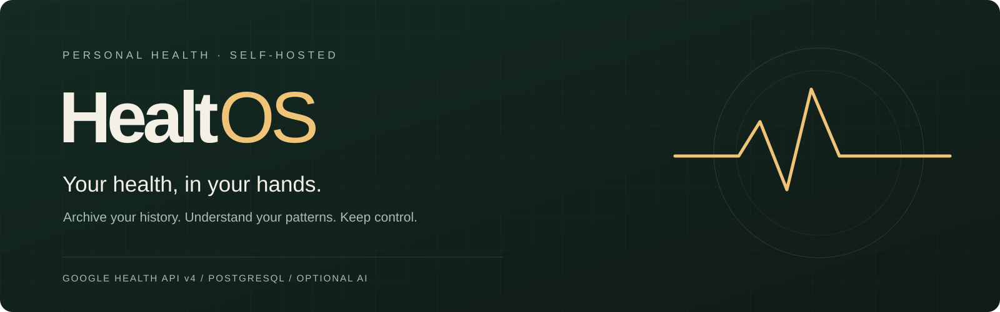
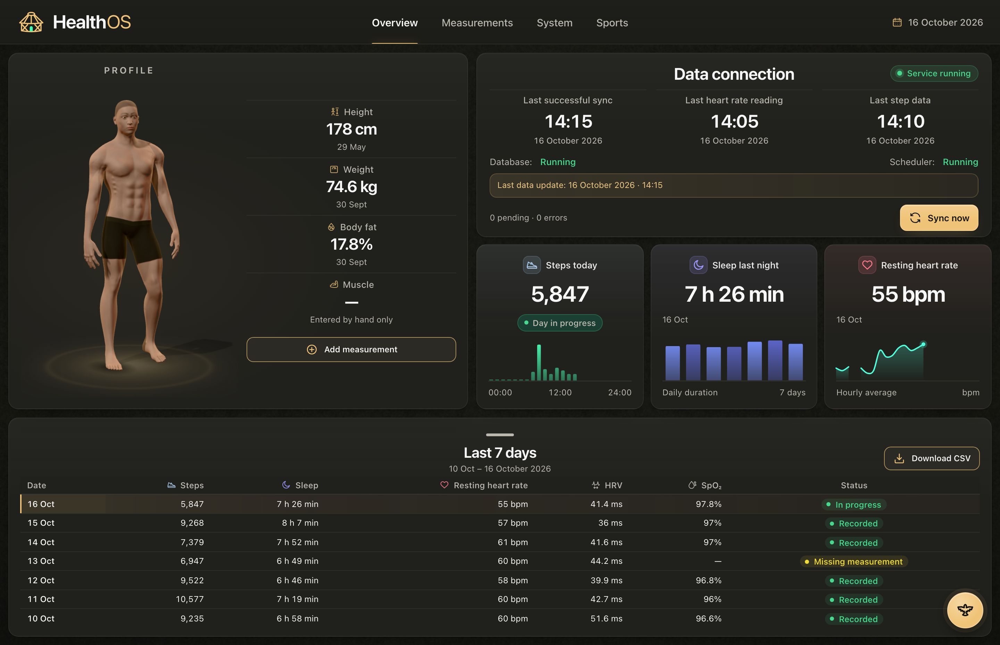
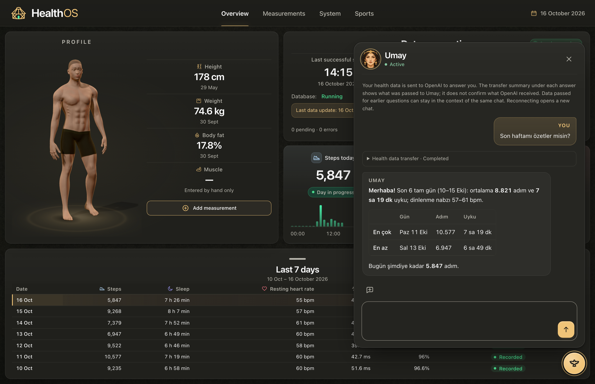
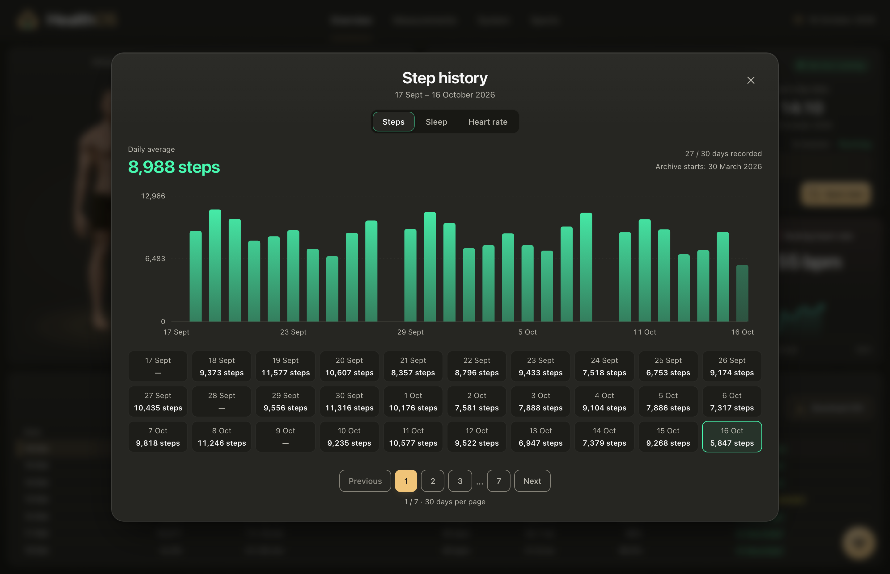
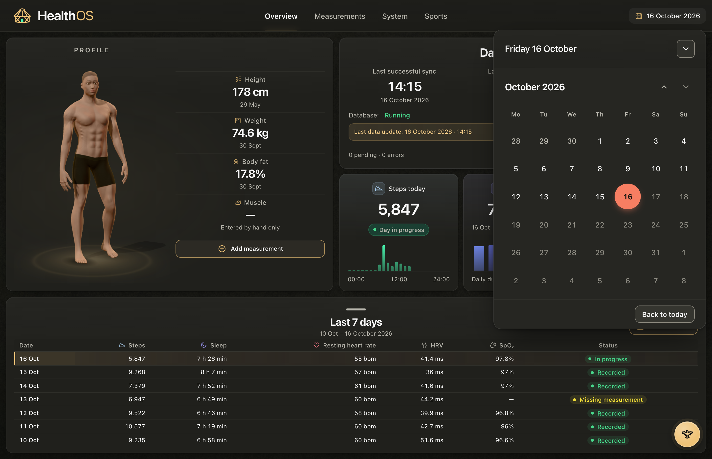
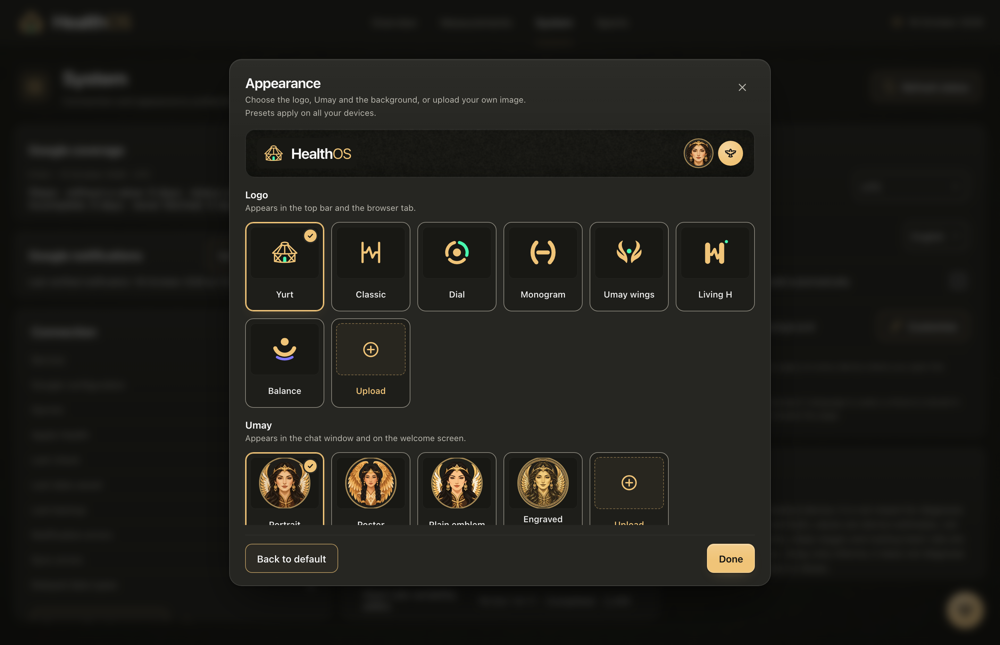
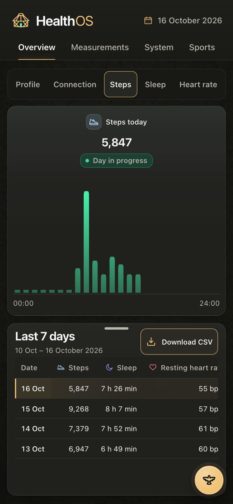
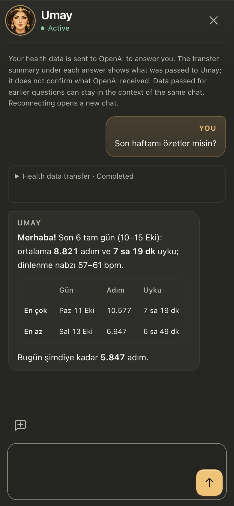
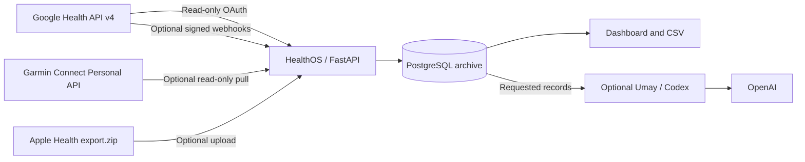

<div align="center">



<p><strong>A self-hosted, read-only archive for your Google Health, Garmin and Apple Health data, with a calm dashboard on top.</strong></p>

[](https://github.com/M3rgen/HealthOS/actions/workflows/ci.yml)
[](https://github.com/M3rgen/HealthOS/releases/tag/v0.2.2)
[](LICENSE)


[What it does](#what-it-does) · [Preview](#a-closer-look) · [Get started](#get-started) · [Install guide](docs/INSTALL.md) · [Privacy](#privacy-and-scope) · [Documentation](#documentation) · [Changelog](CHANGELOG.md)

</div>

---

> **Türkçe kurulum:** Kurulum sihirbazı Türkçe de konuşur. Adım adım Türkçe rehber: [docs/INSTALL.tr.md](docs/INSTALL.tr.md).

HealthOS copies the health and fitness records you can read through **Google Health API v4** into a PostgreSQL database you operate. It can also pull your own **Garmin Connect** data through Garmin's Personal API and import **Apple Health** exports; every source is optional. It keeps the original payloads before anything is normalized, shows daily movement, sleep, heart rate, HRV and oxygen saturation in a single-screen dashboard, and lets you export your history whenever you want. An optional companion, **Umay**, can help you read the archive through a separate Codex conversation.

The archive and dashboard need no AI subscription. HealthOS is a personal, single-user application, not a hosted or multi-user service.

> [!NOTE]
> **Language.** Most documentation is in English; the dashboard, Umay's voice and a few newer operational notes are in Turkish.
>
> **Fitbit Web API shutdown.** Support for the legacy Fitbit Web API ended on September 30, 2026, and the API shut down completely on October 30, 2026. For Fitbit data HealthOS uses only Google Health API v4 (`health.googleapis.com/v4`), Google OAuth and `googlehealth.*` scopes, so it is not affected.
>
> *Eski Fitbit Web API'nin desteği 30 Eylül 2026'da sona erdi ve API 30 Ekim 2026'da tamamen kapandı. HealthOS yalnızca Google Health API v4'ü (`health.googleapis.com/v4`), Google OAuth'u ve `googlehealth.*` scope'larını kullandığı için bu kapanıştan etkilenmez.*

> [!IMPORTANT]
> **API availability.** As of October 3, 2026, Google says new Google Health API projects are not being onboarded. Real synchronization requires an eligible Google Cloud project and a linked Google Health account. Without credentials you can still run the empty dashboard, manual entries and the automated tests. Check the [official setup guide](https://developers.google.com/health/setup) before planning an integration.

## What it does

| Capability | What it gives you |
| --- | --- |
| **Daily overview** | Steps, sleep, resting heart rate, HRV and SpO₂, with hourly charts where records exist. |
| **History and export** | Weekly and monthly views, a draggable history panel and CSV downloads. |
| **Body and workouts** | Manual body measurements and workouts next to archived source records, on one workout timeline. Manual entries can be flagged as test entries without being deleted. |
| **Several sources** | Google Health (Fitbit, Pixel Watch), Garmin Connect and Apple Health side by side; when two sources report the same thing, one is shown first and the other stays visible as an alternative, never summed. |
| **Raw-first storage** | Original payloads and verbatim Google responses are kept before normalization; unknown fields stay available, and record versions are preserved rather than overwritten. |
| **Reliable archiving** | Resumable backfills, overlapping incremental sync, signed webhooks, daily reconciliation and persisted checkpoints. |
| **Evidence you can check** | A coverage report per data type and day with retrieval receipts, a reconciliation history of new, changed and source-deleted records, and webhook diagnostics with separate failure counters. |
| **Local operations** | Encrypted PostgreSQL backups with a status endpoint, integrity checks, sync status and bounded automatic recovery. |
| **Optional Umay chat** | Read-only archive tools for summaries, personal baselines, sleep, intraday and session structure, and a per-turn receipt of what was sent to the model. |

Missing measurements stay missing; they never become zero. Google health-data endpoints are read-only in this application, and manual entries live separately in your local database.

## A closer look



<table>
<tr>
<td width="50%" valign="top"><br /><sub><b>Umay.</b> The optional chat bubble answers from your archive and shows a per-turn receipt of what was sent.</sub></td>
<td width="50%" valign="top"><br /><sub><b>Metric history.</b> Steps, sleep and resting heart rate in 30-day pages; missing days stay empty.</sub></td>
</tr>
<tr>
<td width="50%" valign="top"><br /><sub><b>Date picker.</b> Open any earlier day from the header; the cards and the seven-day table follow it.</sub></td>
<td width="50%" valign="top"><br /><sub><b>Appearance.</b> Logo, Umay portrait and background presets, or your own image. Presets follow you across devices; uploads stay in the browser.</sub></td>
</tr>
</table>

<sub>Actual application interface, captured with the synthetic preview harness in <code>frontend/preview</code> (desktop 1440×900, mobile 390×844). No personal health records are included. The anatomical model is a generic reference.</sub>

<details>
<summary>See the mobile layout</summary>

<p align="center">&nbsp;</p>

</details>

## How it fits together



FastAPI serves the Vite/Three.js frontend. PostgreSQL stores the archive and synchronization state. APScheduler runs reconciliation inside the app, so no separate queue is needed. Docker builds the frontend, so the host does not need Node.js for the Docker setup. The app and database containers run with a read-only root filesystem and `no-new-privileges`.

## Get started

The guided installer sets everything up: it checks Docker, writes `.env` with fresh secrets, configures your data sources, schedules encrypted backups and autostart, and starts the stack. It asks its questions in English or Turkish. **The default target is a Linux server**; the installer also covers Raspberry Pi, NAS, macOS, Windows and cloud VPS.

**Linux, Raspberry Pi, VPS, macOS:**

```sh
curl -fsSL https://raw.githubusercontent.com/M3rgen/HealthOS/main/install.sh | bash
```

**Windows 10/11** (PowerShell):

```powershell
irm https://raw.githubusercontent.com/M3rgen/HealthOS/main/install.ps1 | iex
```

**Pinned to release v0.2.2:**

```sh
curl -fsSL https://raw.githubusercontent.com/M3rgen/HealthOS/v0.2.2/install.sh | bash -s -- --ref v0.2.2
```

```powershell
& ([scriptblock]::Create((irm https://raw.githubusercontent.com/M3rgen/HealthOS/v0.2.2/install.ps1))) -Ref v0.2.2
```

**Prefer to read before running?** Clone, read the script, then run it from the checkout (`--dry-run` prints every action without doing it):

```sh
git clone https://github.com/M3rgen/HealthOS.git
cd HealthOS
./install.sh --dry-run
./install.sh                 # Windows: powershell -ExecutionPolicy Bypass -File .\install.ps1
```

When it finishes, open **[localhost:8000](http://localhost:8000)** and enter the access token it printed (on a server, through an SSH tunnel). Re-running the installer is safe: it copies `.env` to a dated backup before any change, never replaces an existing secret, never removes a volume and never deletes a backup. A re-run changes only the few `.env` values listed in [what the installer changes](docs/INSTALL.md#what-the-installer-changes-and-what-it-never-does), and it keeps the previous mode (trial or full) unless you pass `--mode`. The default platform is Linux on a Linux host; on macOS or Windows the installer preselects that host's own platform. Every option, the trial and full modes and per-platform details are in the [installation guide](docs/INSTALL.md).

### Install with an AI agent

A coding agent with shell access can do the installation for you by following [AI_INSTALL.md](docs/AI_INSTALL.md). Give it this prompt:

```text
Install HealthOS on this computer by following https://raw.githubusercontent.com/M3rgen/HealthOS/main/docs/AI_INSTALL.md — ask me before any step that needs admin rights or my accounts, and never delete data.
```

```text
Bu bilgisayara HealthOS'u kur: https://raw.githubusercontent.com/M3rgen/HealthOS/main/docs/AI_INSTALL.md adımlarını izle; yönetici izni ya da hesap bilgisi gereken her adımdan önce bana sor ve hiçbir veriyi silme.
```

Ready to run in a terminal, with [Claude Code](https://docs.claude.com/en/docs/claude-code/overview) or the OpenAI Codex CLI:

```sh
claude "Install HealthOS on this computer by following https://raw.githubusercontent.com/M3rgen/HealthOS/main/docs/AI_INSTALL.md — ask me before any step that needs admin rights or my accounts, and never delete data."
codex "Install HealthOS on this computer by following https://raw.githubusercontent.com/M3rgen/HealthOS/main/docs/AI_INSTALL.md — ask me before any step that needs admin rights or my accounts, and never delete data."
```

Or paste the prompt into Claude Code, Codex or any other agent that can run commands. The agent asks you the same questions as the installer, shows a dry run first, then runs the installer non-interactively with your answers.

### Platforms

| Platform | Requirements | Guide |
| --- | --- | --- |
| **Linux server / VM** (default) | 64-bit Debian, Ubuntu, Fedora or similar (also a Proxmox VM/LXC); Docker Engine with Compose v2; Git; `age` and Python 3.11+ for backups | [Linux](docs/INSTALL.md#linux-server-or-vm-default) |
| **Raspberry Pi / ARM64** | 64-bit OS (32-bit ARM is not supported); 4 GB RAM or more recommended; SSD rather than SD card for the database; slow first build | [Raspberry Pi](docs/INSTALL.md#raspberry-pi-and-other-arm64-boards) |
| **NAS** (Synology, QNAP, Unraid, TrueNAS SCALE) | x86-64 or ARM64 model with a Docker/Compose app and SSH | [NAS](docs/INSTALL.md#nas-synology-qnap-unraid-truenas-scale) |
| **macOS** (Apple Silicon or Intel) | Docker Desktop, OrbStack or Colima; Git; `brew install age` and Python 3.11+ for backups | [macOS](docs/INSTALL.md#macos) |
| **Windows 10/11** | Docker Desktop with WSL 2; Git for Windows; `winget install FiloSottile.age` | [Windows](docs/INSTALL.md#windows-10-and-11) |
| **Cloud VPS** | As Linux; only SSH open to the internet | [Cloud VPS](docs/INSTALL.md#cloud-vps) |

Every platform runs the same Compose files and images (amd64 and arm64). Daily encrypted backups, autostart after a reboot and the optional Umay bridge use the host's own scheduler: systemd on Linux, launchd on macOS, Task Scheduler on Windows. A modern browser with WebGL shows the dashboard. Internet access is needed to build images and to synchronize; Umay also needs access to OpenAI.

### Data sources

| Source | Devices | What you need | Guide |
| --- | --- | --- | --- |
| **Google Health API v4** | Fitbit, Pixel Watch, Google Health app | An eligible Google Cloud project with API access, an OAuth web client and a linked Google Health account | [Google](docs/INSTALL.md#google-health-api-v4-fitbit-pixel-watch) |
| **Garmin Connect Personal API** | Garmin watches | A Personal API key from Garmin Connect, kept in a file (off by default) | [Garmin](docs/INSTALL.md#garmin-connect-personal-api) |
| **Apple Watch / Apple Health** | Apple Watch, iPhone | Nothing for an `export.zip` upload; the Health Auto Export app for automatic uploads (receiver off by default) | [Apple](docs/INSTALL.md#apple-watch--apple-health) |
| **None for now** | — | Nothing: manual entries and an empty dashboard; add a source later | [None](docs/INSTALL.md#none-for-now) |

### Manual setup

The installer only automates these steps; you can do them by hand. Details for every step are in the [installation guide](docs/INSTALL.md) and, for a production server, the [deployment guide](docs/DEPLOYMENT.md). Native development without Docker (Python 3.12+, `uv` 0.12.1, PostgreSQL, Node.js 24) is described in [Development](docs/DEVELOPMENT.md).

#### 1. Clone and configure

```sh
git clone https://github.com/M3rgen/HealthOS.git
cd HealthOS
cp -n .env.example .env     # -n: never overwrite an existing .env
python3 -c "import secrets; print(secrets.token_hex(32))"        # POSTGRES_PASSWORD
python3 -c "import secrets; print(secrets.token_urlsafe(32))"    # APP_UI_TOKEN
```

Put the two values in `.env`. This manual path is for installs without the installer; the installer writes the same file for you. `APP_UI_TOKEN` is the access key for the dashboard and API (32 to 512 printable characters without spaces); scripts send it as `Authorization: Bearer <token>`. A hexadecimal `POSTGRES_PASSWORD` avoids URL-escaping issues. `.env` is ignored by Git.

#### 2. Start HealthOS

The Compose file runs the app in production mode, which refuses to start until Google and webhook credentials are configured. For a first local look without Google, select the development override by adding this line to `.env` (the installer does this for you in trial mode):

```sh
echo 'COMPOSE_FILE=docker-compose.yml:docker-compose.dev.yml' >> .env    # Windows: use ';' instead of ':' and set COMPOSE_PATH_SEPARATOR=;
docker compose up -d --build
docker compose ps
```

Open **[localhost:8000](http://localhost:8000)** and enter your `APP_UI_TOKEN`. Without Google credentials the dashboard starts with an empty archive; manual entries remain available. The development override also publishes PostgreSQL on `127.0.0.1:5432` and serves the API documentation at [localhost:8000/docs](http://localhost:8000/docs); production mode serves no `/docs`, `/redoc` or `/openapi.json`. After logging in, [localhost:8000/health](http://localhost:8000/health) shows pipeline status.

#### 3. Connect Google Health

Once your project has API access:

1. Follow Google's [Cloud and OAuth setup guide](https://developers.google.com/health/setup). Link your account in the Google Health mobile app first.
2. Create a **Web application** OAuth client and allow this redirect URI: `http://localhost:8000/auth/google/callback`.
3. Configure the required **read-only** scopes. Optionally narrow the mirrored types with `ENABLED_DATA_TYPES`; see the [configuration reference](docs/REFERENCE.md#configuration).
4. Put `GOOGLE_CLIENT_ID` and `GOOGLE_CLIENT_SECRET` in `.env`. Generate a Fernet key with the built image and save it as `GOOGLE_TOKEN_ENCRYPTION_KEY`:

   ```sh
   docker compose run --rm --no-deps app python -c "from cryptography.fernet import Fernet; print(Fernet.generate_key().decode())"
   ```

5. Apply the updated environment (keep the development override until the webhook values below are set), then visit **[Connect Google](http://localhost:8000/auth/google/start)** and complete consent:

   ```sh
   docker compose up -d --force-recreate app
   ```

6. Check access, then synchronize a small dataset:

   ```sh
   docker compose exec app health-mirror probe --days 30
   docker compose exec app health-mirror sync steps
   docker compose exec app health-mirror status
   ```

For unattended operation, run the plain `docker compose up -d` (production mode). It also requires an HTTPS `GOOGLE_HEALTH_WEBHOOK_ENDPOINT_URI` and a `GOOGLE_HEALTH_WEBHOOK_AUTHORIZATION` value; the [deployment guide](docs/DEPLOYMENT.md) walks through a server setup with the dashboard behind an SSH tunnel and a webhook-only Cloudflare Tunnel.

Google's Testing-mode refresh tokens expire after seven days. Follow the applicable Google publication and verification requirements before relying on unattended synchronization; details are in the [technical reference](docs/REFERENCE.md#oauth-and-google-health-setup).

#### 4. Bring in your history

Set `BACKFILL_START_DATE` in `.env` to the earliest date you want to attempt, recreate the app to apply it, then run:

```sh
docker compose exec app health-mirror backfill --data-type steps
# All configured data types; this can take time:
docker compose exec app health-mirror backfill
```

Backfills save progress by type and time window; rerun an interrupted backfill to resume it. Reconciliation and incremental synchronization pick up late-arriving records.

## Optional: Apple Watch / Apple Health

Apple Health data can come in directly, without Google, through two gates. Both are optional;
nothing is fetched from Apple, and the data stays in your database like everything else.

- **Upload the Health app's export.** On the iPhone: Health › your profile picture › *Export All
  Health Data*, and move `export.zip` to the computer that runs HealthOS. On the System page,
  "Apple Sağlık içe aktar" › choose the file › *Yükle*. The file is read as a stream (large
  exports of several gigabytes work), the page shows progress and a summary, and uploading a newer
  export later adds only the new records. Native installs can also run
  `health-mirror apple-import export.zip`.
- **Keep it current with Health Auto Export.** The [Health Auto Export](https://help.healthyapps.dev/en/health-auto-export/export-format)
  iOS app (its REST API automation is a paid feature) can post your data on a schedule. This
  gate is **off by default**: create a token with `health-mirror apple-token` (the installer does this for you), set
  `APPLE_RECEIVER_ENABLED=true`, expose only `POST /webhooks/apple-health` through your own HTTPS
  tunnel or reverse proxy and set `APPLE_RECEIVER_ENDPOINT_URI` to that URL, then add an
  automation with that URL, the header `Authorization: Bearer <token>`, JSON, export version 2.
  The installer does the server side for you with `--apple-receiver yes` (token file, mount and
  `.env` values; see [Apple in the installation guide](docs/INSTALL.md#apple-watch--apple-health)).

Apple data is shown under the source "Apple Sağlık" and follows the same source precedence as
the other sources; overlapping Watch and iPhone samples are never counted twice. The receiver
was built from the app's published format with synthetic test data, not from a real phone. The
settings, the security model and the details are in the
[technical reference](docs/REFERENCE.md#apple-health-github-version).

## Optional: Umay

Umay is a calm, mythology-inspired companion for exploring your health history. It first discovers what your archive contains, then requests the summaries or original records it needs to answer. Its tools cannot modify the archive, and it does not diagnose or suggest medication or doses. Responses are informational.

The supplied launcher, `scripts/start_codex_bridge.py`, starts an isolated, authenticated Codex bridge on the Docker host; the installer can run it as a service (`--umay yes`): the `healthos-bridge` systemd unit in [`deploy/systemd/`](deploy/systemd/) on Linux, a launchd agent on macOS, a scheduled task on Windows. Follow the [bridge setup](docs/REFERENCE.md#local-codex-chat-umay-bridge) or step 9 of the [deployment guide](docs/DEPLOYMENT.md#9-optional-the-umay-bridge). The persona lives in [`app/personas/umay/soul.md`](app/personas/umay/soul.md); the interpretation tools are described in [UMAY_INTERPRETATION](docs/UMAY_INTERPRETATION.md).

**What leaves your machine:** when you use Umay, your questions (with your time zone) and the results of the `health_archive` tool are sent to OpenAI. Each tool call returns a bounded slice, for example daily summaries for up to 366 days, or original Google records for at most 31 days and 200 records per page; Umay may make several calls per question. Every turn shows a transfer receipt with the record counts, date range and field list that were handed to the bridge ([UMAY_TRANSFER](docs/UMAY_TRANSFER.md)). The database itself, whole tables, OAuth tokens, secrets and backups are never sent. The core archive works without this feature.

**Gizlilik:** Umay'a sorduğunuz sorular ve `health_archive` aracının sonuçları OpenAI'ye gider; ham tablolar olduğu gibi gitmez. Araç her çağrıda sınırlı bir parça döndürür: örneğin en fazla 366 günün gün gün özeti ya da en fazla 31 günlük bir aralıktan sayfa başına 200 özgün kayıt. Umay tek bir soru için birkaç sorgu yapabilir. Veritabanının kendisi, OAuth anahtarları ve yedekler hiçbir zaman gönderilmez.

The bridge listens only on loopback or the Docker bridge address, never on all interfaces (`CODEX_BRIDGE_BIND_HOST`). On a Linux host, also restrict port 8766 to Docker bridges with [`deploy/firewall/codex-bridge.nft`](deploy/firewall/codex-bridge.nft) (or the ufw variant next to it).

## Privacy and scope

HealthOS is built for one person keeping their own records on their own hardware.

- **Personal and single-user.** There is one access token, no accounts and no hosted database. There is no application telemetry.
- **Read-only towards every source.** Only read scopes are requested from Google and only read endpoints are called at Garmin; nothing is written back. Nothing is fetched from Apple: Apple data arrives only as a file or request you send.
- **Raw data is preserved.** Source payloads, verbatim responses and record versions are kept; corrections, test-entry flags and identity decisions are recorded alongside the data instead of overwriting it.
- **Nothing listens publicly.** The application port binds to `127.0.0.1` and PostgreSQL has no published port. The dashboard and administrative API stay private behind `APP_UI_TOKEN` and an SSH tunnel; a public deployment exposes only the webhook route (and, if you enable it, the Apple receiver route with its own token), with request-size and rate limits.
- **Secrets stay local.** OAuth refresh tokens are encrypted in PostgreSQL; keep the encryption key separately. Real health records, secrets, logs, backups and local verification outputs are excluded from this repository.

### Backups

Backups are encrypted and automated: [`scripts/backup.sh`](scripts/backup.sh) runs daily at 03:30 from a systemd timer ([`deploy/systemd/`](deploy/systemd/healthos-backup.timer)) on Linux, a launchd agent on macOS, or a Task Scheduler task running its PowerShell twin, `scripts/backup.ps1`, on Windows; the installer sets the schedule up (`--backups yes`, the default in full mode). It streams `pg_dump` from the Compose `backup` profile through `age` (preferred) or `gpg --symmetric`, writes `BACKUP_HOST_DIR/health-<stamp>.dump.age`, and **keeps every backup forever**: nothing is deleted unless you opt in with `BACKUP_RETENTION_DAYS`. A run refuses to start when the disk is short of space (it never deletes old backups to make room) and records its result in `BACKUP_HOST_DIR/last-backup-status.json`; a separate, read-only status directory lets the app report the last attempt and last success at `GET /health/backup`. The key lives outside `.env` (`BACKUP_AGE_RECIPIENT`, or an age identity the installer can create: `/etc/healthos/backup.key` or `~/.config/healthos/backup.key` on Linux, `~/Library/Application Support/HealthOS/backup.key` on macOS, `%APPDATA%\HealthOS\backup.key` on Windows; see [backups per platform](docs/INSTALL.md#backups)). **Keep a copy of the backup key (or age identity) off the host, for example in a password manager: if it is lost, every backup is unreadable.**

```sh
make backup                                         # one encrypted backup now
make restore FILE=backups/health-<stamp>.dump.age   # restore drill into a scratch database
docker compose exec app health-mirror verify
```

`scripts/restore.sh` never touches the live database: it restores into `health_restore` and compares row counts. Keep `GOOGLE_TOKEN_ENCRYPTION_KEY` with the backup key, away from the backups; a restored archive needs it to decrypt the stored Google tokens. See the [backup and restore reference](docs/REFERENCE.md#database-backup-and-restore) and the [restore drill](docs/RUNBOOK.md#backup-verify-and-restore-drill).

## Documentation

| Guide | Use it for |
| --- | --- |
| [Installation](docs/INSTALL.md) | The installer and its options, every platform, data sources, backups per OS, updating, uninstalling without losing data, troubleshooting. |
| [Kurulum](docs/INSTALL.tr.md) | The same installation guide in Turkish. |
| [Installing with an AI agent](docs/AI_INSTALL.md) | Step-by-step instructions a coding agent follows to install HealthOS for you. |
| [Technical reference](docs/REFERENCE.md) | Data types, scopes, configuration, APIs, record identity, archiving, backups and troubleshooting. |
| [Deployment](docs/DEPLOYMENT.md) | A production Debian VM by hand: Compose, SSH-tunnel access, webhook tunnel, backups, Umay bridge. |
| [Runbook](docs/RUNBOOK.md) | Updates, migrations, key rotation, restore drills and diagnosing a quiet webhook. |
| [Development](docs/DEVELOPMENT.md) | Native setup, validation commands and repository map. |
| [Branches](docs/BRANCHES.md) | `dev`, `main`, extension branches and `live`: what is published and what is installed. |
| [Umay interpretation](docs/UMAY_INTERPRETATION.md) | Baselines, analysis, sleep, intraday, session and relationship tools, and their budgets (Turkish). |
| [Umay transfer receipts](docs/UMAY_TRANSFER.md) | What each chat turn sends to the model and how it is counted. |
| [Performance budget](docs/PERFORMANCE_BUDGET.md) | Initial JS/CSS size ceilings enforced after `vite build` (Turkish). |
| [Cloudflare Tunnel](docs/CLOUDFLARE_TUNNEL.md) | A webhook-only public endpoint. |
| [Image updates](docs/IMAGE_UPDATES.md) | Updating pinned container images. |
| [Windows notes](docs/legacy/WINDOWS.md) | Windows host details (Umay bridge, cloudflared) and the earlier Windows → Linux migration plan. |
| [Changelog](CHANGELOG.md) | What changed in each release. |

## Contributing

Contributions are welcome. Keep changes focused, use synthetic examples only and run the validation described in [CONTRIBUTING.md](CONTRIBUTING.md) and [Development](docs/DEVELOPMENT.md#validation). Never include real health records, tokens or `.env` contents in issues, pull requests or fixtures.

## Project status and license

**Current release: [v0.2.2](https://github.com/M3rgen/HealthOS/releases/tag/v0.2.2).** HealthOS is an evolving personal self-hosted project. The public snapshot includes the application, migrations, the installers, deterministic dependency locks, automated tests and CI. Google access and available records vary by project and account. The interface is Turkish, defaults to UTC, and has English documentation.

Project code is available under the [MIT License](LICENSE). The generic anatomical model retains its [MakeHuman provenance and CC0 license](frontend/public/models/PROVENANCE.md).

HealthOS is an independent project and is not affiliated with Google, Fitbit, Garmin, Apple or OpenAI.
