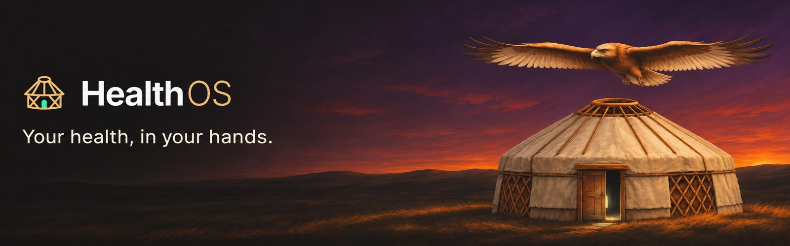

<div align="center">



<p><strong>A self-hosted, read-only archive of your own health data, with a calm dashboard on top.</strong></p>

[](https://github.com/M3rgen/HealthOS/actions/workflows/ci.yml)
[](LICENSE)

[What it does](#what-it-does) · [Get started](#get-started) · [Install guide](docs/INSTALL.md) · [Privacy](#privacy-and-scope) · [Documentation](#documentation) · [Changelog](CHANGELOG.md)

</div>

> **Türkçe kurulum:** Kurulum sihirbazı Türkçe de konuşur. Adım adım Türkçe rehber: [docs/INSTALL.tr.md](docs/INSTALL.tr.md).

HealthOS copies your health and fitness records from your wearables' services into a PostgreSQL database you operate. It keeps the original payloads before anything is normalized, shows daily movement, sleep, heart rate, HRV and oxygen saturation in a single-screen dashboard, and lets you export your history whenever you want. It is built for one person keeping their own records on their own hardware: not a hosted or multi-user service, and not a medical device. The archive and dashboard need no AI subscription; an optional companion, **Umay**, can help you read the archive through a separate Codex conversation.


<sub>Actual interface with synthetic data from the preview harness in <code>frontend/preview</code>; no personal health records. The anatomical model is a generic reference. Umay, the phone layout and more: <a href="docs/SCREENSHOTS.md">Screenshots</a>.</sub>

## What it does

- **Daily overview:** steps, sleep, resting heart rate, HRV and SpO₂ on one screen, with hourly charts where records exist; weekly and monthly history and CSV downloads.
- **Raw-first archive:** original payloads and verbatim Google and Garmin responses are kept before normalization; record versions are preserved, never overwritten. Missing measurements stay missing; they never become zero.
- **Reliable archiving:** resumable backfills, overlapping incremental sync, signed webhooks, daily reconciliation and a coverage report per data type and day.
- **Manual entries:** body measurements and workouts next to the archived source records, on one workout timeline.
- **Local operations:** encrypted backups, integrity checks, sync status and bounded automatic recovery.
- **Optional Umay chat:** read-only archive tools and a per-turn receipt of what was sent to the model.

The dashboard is Turkish by default and has a working English switch at **Sistem › Görünüm › Dil**; the login page, Umay's voice and some CLI messages stay Turkish. Documentation is in English; files named `*.tr.md` are Turkish.

## What you can connect

Every source is optional, and several can run side by side (`HEALTHOS_SOURCES`; see [Sources](docs/reference/sources.md#sources)).

| Source | Status |
| --- | --- |
| **Garmin Connect** (Personal API) | **Start here.** You create the key yourself on [Garmin's Personal API page](https://developer.garmin.com/gc-developer-program/personal/personal-api); steps, sleep, resting heart rate, HRV, SpO₂ and workouts are pulled every two hours. |
| **Google Health API v4** (Fitbit, Pixel Watch) | Only with an already approved project: Google says it has not been onboarding new Google Health API projects since October 3, 2026. The Fitbit Web API shutdown does not affect it ([details](docs/reference/overview.md)). |
| **Apple Health** (Apple Watch, iPhone) | **Included in the published release** as an extension (this checkout has `app/apple/`): upload the Health app's `export.zip`, or let the Health Auto Export app post your data ([Apple Health](#optional-apple-watch--apple-health)). A tree without it starts cleanly with `HEALTHOS_SOURCES=apple` and imports nothing ([details](docs/reference/sources.md#what-is-not-in-this-tree)). |
| **None** (the default) | An empty dashboard, manual entries, or 90 days of synthetic sample data (**Try with sample data**, or `healthos demo`). |

## Get started

The guided installer checks Docker, writes `.env` with fresh secrets, configures your data sources, schedules encrypted backups and autostart, and starts the stack; it asks in English or Turkish. **The default target is a Linux server**; it also covers Raspberry Pi, NAS, macOS, Windows and cloud VPS ([platforms](docs/INSTALL.md#platforms)).

**Linux, Raspberry Pi, VPS, macOS:**

```sh
curl -fsSL https://raw.githubusercontent.com/M3rgen/HealthOS/v0.2.3/install.sh | bash
```

**Windows 10/11** (PowerShell):

```powershell
irm https://raw.githubusercontent.com/M3rgen/HealthOS/v0.2.3/install.ps1 | iex
```

These install the release v0.2.3. When it finishes, open **[localhost:8000](http://localhost:8000)** and enter the access token it printed (on a server, through an SSH tunnel). Re-running it is safe: it backs up `.env` first and never replaces a secret, removes a volume or deletes a backup. Reading the script first with `--dry-run`, the development version, every option and per-platform details are in the [installation guide](docs/INSTALL.md); a coding agent can also install it for you by following [AI_INSTALL.md](https://raw.githubusercontent.com/M3rgen/HealthOS/v0.2.3/docs/AI_INSTALL.md).

### Manual setup

The installer automates the steps below; you can also do them by hand. Requirements for other setups are in [Setup](docs/reference/setup.md#requirements), and a production server behind an SSH tunnel is covered in [Deployment](docs/DEPLOYMENT.md).

### 1. Clone and configure

```sh
git clone --branch v0.2.3 https://github.com/M3rgen/HealthOS.git
cd HealthOS
make env
install -d -m 755 backup-status
```

`make env` writes a mode-600 `.env` with three generated secrets (`POSTGRES_PASSWORD`, `POSTGRES_APP_PASSWORD`, `APP_UI_TOKEN`) and refuses to replace an existing file. To configure by hand instead, run `cp .env.example .env && chmod 600 .env` and follow [Docker setup](docs/reference/setup.md#docker-setup). Create `backup-status` before starting Compose so the host user owns it instead of Docker. The template selects no source (`HEALTHOS_SOURCES=none`).

### 2. Start HealthOS

```sh
docker compose up -d --build
docker compose ps
```

Open **[healthos.localhost:8000](http://healthos.localhost:8000)** and enter your `APP_UI_TOKEN`. The first build takes a few minutes. You get an empty archive, the dashboard and manual entries; the app refuses to start only when a source you selected is missing what it needs. Updating an existing installation: follow the [runbook](docs/RUNBOOK.md#existing-installations-migrate-before-updating) first.

### 3. Connect Garmin

No approval process is involved. Create a key on [Garmin's Personal API page](https://developer.garmin.com/gc-developer-program/personal/personal-api) (Garmin shows it once), save it to a file, and install it for the container's user (UID 10001), readable by that user alone:

```sh
sudo install -d -m 700 -o 10001 -g 10001 /opt/healthos/secrets
sudo install -m 400 -o 10001 -g 10001 <downloaded-key-file> /opt/healthos/secrets/garmin-personal-api-key
sudo setpriv --reuid=10001 --regid=10001 --clear-groups test -r /opt/healthos/secrets/garmin-personal-api-key && echo ok
```

Add to `.env` (Compose reads `COMPOSE_FILE` from it, so no tracked file changes):

```dotenv
COMPOSE_FILE=docker-compose.yml:docker-compose.garmin.yml
HEALTHOS_SOURCES=garmin
GARMIN_API_KEY_HOST_FILE=/opt/healthos/secrets/garmin-personal-api-key
```

Apply it, check the key (this makes no request to Garmin), then pull your first data and as much history as you want:

```sh
docker compose up -d --force-recreate
docker compose run --rm app healthos garmin-status   # "enabled": true, "key_file_present": true
docker compose exec app healthos garmin-pull
docker compose exec app healthos garmin-backfill --since 2026-01-01 --dry-run   # counts requests; drop --dry-run to fetch
```

From then on `garmin-pull` runs every two hours. Errors, key renewal and every setting: [Garmin reference](docs/reference/garmin.md#garmin-connect-personal-api).

### 4. Connect Google Health

Only with a project that already has Google Health API access. You need a **Web application** OAuth client whose redirect URI matches `GOOGLE_REDIRECT_URI` exactly (default `http://healthos.localhost:8000/auth/google/callback`), the client values and a `GOOGLE_TOKEN_ENCRYPTION_KEY` in `.env`, and `google` in `HEALTHOS_SOURCES`; production mode also requires the webhook values. The steps, a first run before webhooks are set up and importing history are in [Google Health with Docker](docs/reference/setup.md#google-health-with-docker).

## Optional: Apple Watch / Apple Health

Apple Health data can come in directly, without Google, through two optional gates; nothing is fetched from Apple.

- **Upload the Health app's export.** On the iPhone: Health › your profile picture › *Export All Health Data*. On the System page, "Apple Sağlık içe aktar" › choose `export.zip` › *Yükle* (native installs: `healthos apple-import export.zip`). Exports of several gigabytes work, and uploading a newer export later adds only the new records.
- **Keep it current with Health Auto Export.** The [Health Auto Export](https://help.healthyapps.dev/en/health-auto-export/export-format) iOS app (its REST API automation is a paid feature) can post your data on a schedule. This gate is **off by default**: it needs a token from `healthos apple-token`, `APPLE_RECEIVER_ENABLED=true` and your own HTTPS route that exposes only `POST /webhooks/apple-health`; the installer does the server side with `--apple-receiver yes` ([Apple in the installation guide](docs/INSTALL.md#apple-watch--apple-health)).

Apple data follows the same source precedence as the other sources; overlapping Watch and iPhone samples are never counted twice. The receiver was built from the app's published format with synthetic test data, not from a real phone. Settings, the app's automation fields and the security model: [Apple Health reference](docs/reference/apple.md).

## Optional: Umay

Umay is a calm, mythology-inspired companion for exploring your health history. It requests the summaries or original records it needs to answer; its tools cannot modify the archive, and it does not diagnose or suggest medication or doses. It runs through a Codex bridge on the Docker host (`scripts/start_codex_bridge.py`; the installer can run it as a service with `--umay yes`) and needs **Codex CLI 0.161.0 exactly** and a ChatGPT login ([bridge setup](docs/DEPLOYMENT.md#9-optional-the-umay-bridge)).

**What leaves your machine:** when you use Umay, your questions (with your time zone) and the results of the `health_archive` tool are sent to OpenAI, in bounded slices; every turn shows a transfer receipt of what was handed to the bridge ([transfer receipts](docs/UMAY_TRANSFER.md), [Privacy](docs/PRIVACY.md#umay-and-openai)). The database itself, whole tables, OAuth tokens, secrets and backups are never sent. The core archive works without this feature.

## Privacy and scope

> [!WARNING]
> **Not a medical device.** HealthOS is not intended for diagnosis or treatment. HRV and SpO₂ values are estimates made by your devices, not clinical measurements; Umay's readings are informational.

- **Personal and single-user.** One access token, no accounts, no hosted database and no application telemetry.
- **Read-only towards every source.** Only read access is requested from Google and Garmin; nothing is written back. Nothing is fetched from Apple: Apple data arrives only as a file or request you send.
- **Raw data is preserved.** Corrections, test-entry flags and identity decisions are recorded alongside the data instead of overwriting it.
- **Nothing listens publicly.** The application binds to `127.0.0.1` behind `APP_UI_TOKEN`; a public deployment exposes only the webhook route (and, if you enable it, the Apple receiver route with its own token), with request-size and rate limits.
- **Secrets stay local.** OAuth refresh tokens are encrypted in PostgreSQL; the Garmin key stays in a file.
- **Backups are encrypted and kept forever**, and they run daily once scheduled: the guided installer does it on every platform (`--backups yes`, the default in full mode; [backups per platform](docs/INSTALL.md#backups)), by hand it is the systemd timer ([deployment step 8](docs/DEPLOYMENT.md#8-encrypted-backups)); `docker compose up` alone takes none. **Keep a copy of the backup key off the host: if it is lost, every backup is unreadable.**

Details, including a GDPR/KVKK note, are in [Privacy](docs/PRIVACY.md) ([Türkçe](docs/PRIVACY.tr.md)).

## Documentation

| Guide | Use it for |
| --- | --- |
| [Installation](docs/INSTALL.md) | The installer and its options, every platform, data sources, backups per OS, updating, uninstalling without losing data, troubleshooting ([Türkçe](docs/INSTALL.tr.md), [with an AI agent](docs/AI_INSTALL.md)). |
| [Technical reference](docs/REFERENCE.md) | Sources, data types, scopes, configuration, APIs, record identity, archiving, backups and troubleshooting. |
| [Deployment](docs/DEPLOYMENT.md) | Installing on a Debian server: Compose, SSH-tunnel access, webhook tunnel, backups, Umay bridge. Also: [Cloudflare Tunnel](docs/CLOUDFLARE_TUNNEL.md), [image updates](docs/IMAGE_UPDATES.md), [Windows notes](docs/legacy/WINDOWS.md). |
| [Runbook](docs/RUNBOOK.md) | Updates, key rotation, restore drills, record-identity decisions and diagnosing a quiet webhook. |
| [Migration notes](docs/MIGRATIONS.md) | What each schema migration since `20261020_0010` changed, its locks and rollback; refused downgrades. |
| [Development](docs/DEVELOPMENT.md) | Native setup, validation and CI gates, releases and repository map. |
| [Architecture](docs/ARCHITECTURE.md) | Layers and import rules, data flow, and the reasons behind the raw tables and the identity layer. |
| [Privacy](docs/PRIVACY.md) | Medical scope, where the data lives, exactly what Umay sends to OpenAI, GDPR/KVKK. |
| [Umay](docs/UMAY_INTERPRETATION.md) | Umay's interpretation tools and budgets; what each turn sends is in [transfer receipts](docs/UMAY_TRANSFER.md). |
| [Screenshots](docs/SCREENSHOTS.md) | Every view captured with synthetic data, desktop and phone. |
| [Performance budget](docs/PERFORMANCE_BUDGET.md) | Initial JS/CSS size ceilings enforced after `vite build`. |

## Contributing

Contributions are welcome. Keep changes focused, use synthetic examples only and run the validation described in [CONTRIBUTING.md](CONTRIBUTING.md) and [Development](docs/DEVELOPMENT.md#validation). Never include real health records, tokens or `.env` contents in issues, pull requests or fixtures.

## Project status and license

**Latest published release: [v0.2.3](https://github.com/M3rgen/HealthOS/releases/tag/v0.2.3).** This source tree declares 0.2.3 ([Changelog](CHANGELOG.md)). Upgrading a v0.2.2 install is covered in the [runbook](docs/RUNBOOK.md#upgrade-from-v022).

Project code is available under the [MIT License](LICENSE). The generic anatomical model retains its [MakeHuman provenance and CC0 license](frontend/public/models/PROVENANCE.md). HealthOS is an independent project and is not affiliated with Google, Fitbit, Garmin, Apple or OpenAI.
