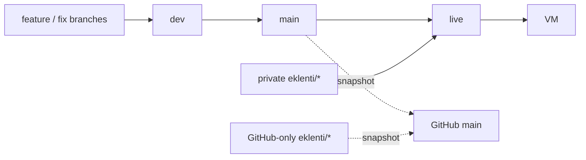

# Branches

HealtOS is developed on a private Git mirror and published on GitHub. A few features run only on
the maintainer's own server; others are published but not run by the maintainer. Both live on
separate extension branches so that neither tree needs hand-pruning before a release.

## Layout

| Branch | Meaning | Published to GitHub |
| --- | --- | --- |
| `dev` | Continuous work. Feature and fix branches merge here first. Contains no extension code. | No |
| `main` | Stable. Updated from `dev` when a batch is verified. Contains no extension code; its tree, merged with the GitHub-only extensions and less the snapshot exclusions, is what GitHub `main` shows. | Yes, as a snapshot |
| `eklenti/<name>` (private) | One private extension, nothing else. Starts from `main` and carries only the extension's own files and lines. | **Never** |
| `eklenti/<name>` (GitHub-only) | One published extension the maintainer does not run, e.g. `eklenti/apple`. Same shape as a private one. Never on the Gitea mirror, never in `live`. | Yes, as part of the snapshot (the branch itself may be pushed too) |
| `live` | `main` merged with every private extension branch. The commit installed on the maintainer's VM. | **Never** |



## Flow

1. Work lands on `dev` (`git merge --no-ff <branch>`), then `make verify` on `dev`.
2. A verified `dev` is merged into `main`.
3. Each extension branch takes the new `main` (see below) and is verified on its own.
4. `live` is rebuilt from `main` plus the private extensions and installed on the VM:

   ```sh
   git switch live
   git merge --ff-only main            # or --no-ff when live already holds extension merges
   git merge --no-ff eklenti/<name>    # once per private extension branch
   make verify
   ```

5. GitHub `main` receives the tree of `main` plus the GitHub-only extensions through the
   snapshot below. Nothing is pruned by hand; if a pruning step seems necessary, extension code
   has leaked into `main` and must be moved back to its branch first.

History is never rewritten and nothing is force-pushed. Removing a feature from `main`/`dev`
happens with an ordinary removal commit; the extension branch adds it back.

## Keeping an extension up to date

Prefer merging over rebasing, because the extension branch is already pushed (to the mirror, or
to GitHub for a GitHub-only one) and a rebase would need a force push:

```sh
git switch eklenti/<name>
git merge main                      # resolve conflicts only in the extension's own lines
make verify
git diff main eklenti/<name> --stat # must list only the extension's files
```

`git rebase main` is acceptable only while the branch has never been pushed.

When `main` changes code the extension hooks into (for example the scheduler, the runtime
container or the settings class), adapt the extension in its own branch; never add hooks for an
extension to `main` or `dev`.

## GitHub-only extensions

The opposite of a private extension: a feature published on GitHub that the maintainer does not
run, for example Apple Health import on `eklenti/apple`. Its tree is part of GitHub `main`, but
it never reaches the private mirror's `dev`/`main` nor `live` and the VM. Which branches are
GitHub-only is local git config, like the other `healthos.*` settings:

```sh
git config --add healthos.githubExtension eklenti/apple        # once per branch
git config --add healthos.githubExtensionMarker <word>         # distinctive identifiers of its code
```

The marker words (for example its settings prefix) stay out of the repository for the same
reason as `healthos.extensionMarker`. Keeping the branch up to date:

```sh
git switch eklenti/apple
git merge main                      # never rebase once pushed; resolve only the extension's lines
make verify
git diff main eklenti/apple --stat  # must list only the extension's files and lines
```

- It is never merged into `dev`, `main` or `live`.
- Its migrations chain after `main`'s head, so the branch owns two lines that `main` does not:
  the `down_revision` of its first migration (a merge migration when `main` adds one) and
  `HEAD` in `tests/integration/test_pg_migrations.py`, which names the branch's own head.
  Resolve both on every `git merge main`.
- The branch may be pushed to GitHub only (`git push github eklenti/apple`), never to the Gitea
  mirror.
- The snapshot merges it automatically (see below).
- `scripts/check_no_extension.sh` (`main dev`) must stay clean, and so must
  `scripts/check_no_extension.sh --github-only live`.

### Migrations of a GitHub-only extension

The extension's first migration has `down_revision` set to `main`'s head at the time. When `main`
later adds a migration, `main` plus the extension has two heads. After `git merge main` into the
extension, add a **new** merge migration on the extension branch whose `down_revision` is the
tuple `(<extension head>, <main head>)`. Never rewrite an existing migration's `down_revision`:
installed databases would skip revisions. The snapshot script refuses a tree with more than one
head.

Alembic branch labels with `upgrade heads` were rejected: the Dockerfile, `make migrate`, the
tests and a few readers (`SELECT version_num FROM alembic_version`) assume a single head and a
single row.

## Rules

- `live` and private `eklenti/*` are never pushed to GitHub, not even temporarily. GitHub-only
  `eklenti/*` are never pushed to the mirror.
- The VM is installed from `live`, not from `main` (see [DEPLOYMENT.md](DEPLOYMENT.md)).
- Private extension settings stay in the VM's `.env`; `.env.example` on `main` does not list them.
- `scripts/check_no_extension.sh` checks locally that `main` and `dev` contain no trace of any
  extension branch, private or GitHub-only. The words it looks for are kept out of the
  repository; set them once per clone with `git config --add healthos.extensionMarker <word>`
  (without one it exits 2 rather than report clean). `--github-only <rev>` runs only the
  GitHub-only checks. Run it before every update of GitHub `main`. It is not part of CI.

## GitHub snapshot

GitHub `main` is not pushed from `main` directly. `scripts/github_snapshot.sh` builds one commit
whose tree is the tree of `main`, merged with every `healthos.githubExtension` branch, minus a
short exclusion list, on top of the local `github-main` branch, and fast-forwards that branch; it
merges with `git merge-tree`, works in a temporary index and never touches a working tree. A
merge conflict stops it (merge `main` into the extension and resolve there), and so does a tree
with more than one Alembic head; `--no-extensions` publishes `main` alone. The exclusion list and the commit identity are local git settings, not files in the
repository (`git config --add healthos.githubExclude <path>`, `healthos.githubAuthorName`,
`healthos.githubAuthorEmail`). The list holds maintainer-only material: notes and workflow files of
the private automation, and documents or tests tied to the maintainer's own archive or devices. An
entry may be a file or a directory. The script refuses to update the branch while the new tree
still names an excluded file (by name, or as a whole word without its extension, which catches an
import of an excluded test helper) or an excluded directory, so public files must not link to or
import them; a test that imports an excluded helper is excluded with it. Contribution rules live
in `CONTRIBUTING.md`, which is published.
Before any push, run `scripts/check_no_extension.sh github-main` (no private trace; GitHub-only
code is expected there) and `scripts/check_no_extension.sh --github-only live`.
