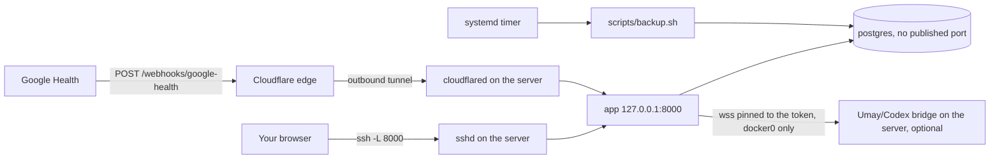

# Deployment

This is the supported way to run HealthOS for real: one Debian server running Docker Compose, the
dashboard reachable only through an SSH tunnel, and, when Google is selected, a Cloudflare Tunnel
that forwards nothing but Google's webhook. Day-two procedures (updates, key rotation, restore
drills, diagnosis) are in the [runbook](RUNBOOK.md). For a quick local trial, the
[README](../README.md#get-started) is enough.

The guided installer (`install.sh`, see [INSTALL.md](INSTALL.md#linux-server-or-vm-default))
automates steps 1 to 4 and 8 of this guide, and installs the bridge unit of step 9 on request; it
never overwrites `.env` or deletes anything. This page remains the manual reference for the same
setup. Other platforms (Raspberry Pi, NAS, macOS, Windows, cloud VPS) are covered in
[INSTALL.md](INSTALL.md#platforms).

Which sources run is `HEALTHOS_SOURCES` in `.env`: the template sets `none`, Garmin-only is
`garmin` (the [README's Connect Garmin steps](../README.md#3-connect-garmin) work on a server as
written; `/opt/healthos/secrets` is then inside the checkout, which `.gitignore` and `.dockerignore`
exclude from Git and image builds), and steps 3 and 6–7 below are the Google path.

Placeholders: `<server-host>` is the server's SSH address, `<user>` your SSH account, `webhook.example.com`
the public webhook hostname, `/opt/healthos` the checkout directory (the systemd backup unit assumes
that path; adjust it there if you choose another).

## What runs where



| Component | Where | Source in this repository |
| --- | --- | --- |
| `app` (FastAPI + built frontend) | Compose, published on `127.0.0.1:${APP_PORT:-8000}` only; the container always listens on 8000 | `Dockerfile`, `docker-compose.yml` |
| `migrate`, `provision-app-role` | Compose, one-shot on every `up`: migrations as the schema owner, then the app's non-superuser role and grants | `docker-compose.yml`, `scripts/provision_app_role.py` |
| `postgres` 17 | Compose, internal network, no host port, volume `postgres_data` | `docker-compose.yml` |
| `backup` | Compose profile, started on demand by the backup script | `docker-compose.yml`, `scripts/backup.sh` |
| Backup schedule | Host systemd timer, daily 03:30 UTC | `deploy/systemd/` |
| Webhook ingress | Host `cloudflared` systemd service | `deploy/cloudflare/`, [CLOUDFLARE_TUNNEL.md](CLOUDFLARE_TUNNEL.md) |
| Umay bridge (optional) | Host process: TLS front on port 8766 (firewalled to Docker bridges) that ends the WebSocket and lets through only the chat's seven RPCs, Codex app-server behind it on a private loopback port | `scripts/start_codex_bridge.py`, `scripts/codex_bridge_front.py`, `deploy/firewall/` |

Nothing listens publicly: the router needs no port forwarding, and the server's firewall only needs to
allow SSH from your management network plus outbound HTTPS/DNS. The `caddy` service in the `webhook`
profile is an alternative that needs inbound ports 80/443; this guide does not use it.

Every container in the Compose file (`app`, `postgres`, `migrate`, `provision-app-role`, `backup`,
`caddy`) has a read-only root filesystem, `no-new-privileges`, a dropped capability set and memory
and process limits. Limits come from `.env` where the [configuration reference](reference/config.md#configuration)
lists them. The app runs as the image's `healthos` user (UID 10001) and writes temporary files only to its `/tmp` tmpfs.
PostgreSQL persists data at the unchanged `postgres_data:/var/lib/postgresql/data`
named volume; `/tmp` (mode `1777`) and `/var/run/postgresql` (mode `3775`) are
writable tmpfs mounts. Its root entrypoint still fixes ownership and switches to
the postgres user; no fixed `user` override is needed. Temporary files and sockets
disappear when the container is recreated; database data remains in the volume.

`make compose-smoke` verifies all of this on a Docker host with bash and age (plus age-keygen) or
gpg, plus uv for the Make target. Without uv, run `python3 scripts/verify_compose.py`
with Python 3.11+; it runs the same drill using only the standard library. The drill pins the production Compose file to a randomly named isolated project with synthetic
credentials and data, on a random host port, and does not read your `.env` (it points
`COMPOSE_ENV_FILES` at an empty file), so a filled-in `.env` neither changes nor breaks it. It checks empty-volume startup, both services' runtime protections and tmpfs
write permissions, persistence after PostgreSQL restart and container recreation using the existing
volume, the application role (fresh install, upgrade from an owner connection and rollback), the Garmin key mount,
then the encrypted backup/restore and migration checks. During backup/comparison the app is
stopped so synthetic data cannot change; every public base table must have equal row counts. The
drill also checks protected backup health, atomic metadata updates and success → failure → app
recreation. It removes only its own project volumes, the images it built under its random project
prefix and its throwaway backup/status artifacts, and must not be redirected to the production
project or database.

## 1. Prepare the server

Debian 12 (bookworm) with a few GB of disk beyond the archive itself is the verified platform.
On a minimal Debian installation, `sudo` may be absent. As root, install it and grant your
deployment account access (replace `<user>`), then log out and back in:

```sh
apt update
apt install sudo
usermod -aG sudo <user>
```

Install Docker Engine and the Compose plugin with [Docker's Debian instructions](https://docs.docker.com/engine/install/debian/),
then the tools the scripts use:

```sh
sudo apt install git age python3 make rsync  # Python 3.11+ for metadata; rsync for backup disk copies
sudo systemctl enable --now docker
docker compose version
```

Docker starts at boot, and the containers come back on their own (`restart: unless-stopped`).

## 2. Get the code

```sh
sudo git clone https://github.com/M3rgen/HealthOS.git /opt/healthos
sudo chown -R "$USER" /opt/healthos
cd /opt/healthos
cp .env.example .env
chmod 600 .env
```

Your user must be able to run `docker`. Add it to the `docker` group, then log out and back
in before continuing (Docker group membership grants root-equivalent access):

```sh
sudo usermod -aG docker "$USER"
```

Alternatively, run Docker commands with `sudo`.

The maintainer's server may use a locally configured deployment revision. Follow the
maintainer's checkout instructions there; public installations use `main` as shown above.

## 3. Fill in `.env`

The Compose file sets `APP_ENV=production` for migrations and the app. Until the values that apply
to your `HEALTHOS_SOURCES` are set, the first refusal appears in `docker compose logs migrate` as
`unsafe or missing production configuration: <names>`; the app does not start. `POSTGRES_PASSWORD` and `APP_UI_TOKEN` are always required;
`none`, `garmin` and `apple` need no Google value (`garmin` needs a readable
`GARMIN_API_KEY_FILE`, which [`docker-compose.garmin.yml`](../docker-compose.garmin.yml) provides;
see the [README](../README.md#3-connect-garmin)). The other rows are required only with `google`:

| Variable | How to get it |
| --- | --- |
| `POSTGRES_PASSWORD` | `python3 -c "import secrets; print(secrets.token_hex(32))"` (hex avoids URL escaping). Used only by `postgres`, `migrate`, `provision-app-role` and `backup`; it is not passed to the app. |
| `POSTGRES_APP_USER`, `POSTGRES_APP_PASSWORD` | The non-superuser role the app connects with; the template sets the user to `healthos_app`. Generate the password the same way (24–512 URL-safe characters that pass the [strength check](reference/config.md#secret-strength); `POSTGRES_PASSWORD` must pass it too). Set both: with one missing `provision-app-role` exits and the app does not start. With neither, a new (empty) database stops there too (`POSTGRES_ALLOW_OWNER_RUNTIME=1` overrides that). A database that already holds records keeps connecting as the owner, which the postgres image makes a superuser, and production refuses to start as a superuser: the log line `DATABASE_ROLE_SUPERUSER_REFUSED` names the step (set these two, `docker compose up -d`). `HEALTHOS_ALLOW_SUPERUSER_UNTIL=<YYYY-MM-DD>`, at most 30 days ahead, keeps it starting until that day, with a warning and the `/health` reasons `database_role_superuser` and `database_role_superuser_grace`. The role must not be a member of the owner or of a privileged role (`provision-app-role` refuses it, since `NOINHERIT` does not stop `SET ROLE`); production also refuses to start with such a login (`DATABASE_ROLE_PRIVILEGED_REFUSED`), or one with `CREATEROLE`, `CREATEDB`, `REPLICATION` or `BYPASSRLS`; see [runbook](RUNBOOK.md#application-database-role). |
| `APP_UI_TOKEN` | `python3 -c "import secrets; print(secrets.token_urlsafe(32))"`. 32–512 printable characters, no spaces, and it must pass the [strength check](reference/config.md#secret-strength). This is the dashboard password. |
| `GOOGLE_CLIENT_ID`, `GOOGLE_CLIENT_SECRET` | Your OAuth **Web application** client ([README step 4](../README.md#4-connect-google-health)). Register the default redirect URI `http://healthos.localhost:8000/auth/google/callback` in Google Cloud Console before connecting (use your installation's port). Existing installations may keep an explicit `GOOGLE_REDIRECT_URI=http://localhost:8000/auth/google/callback` in `.env`; if unset, register the new default before upgrading to avoid `redirect_uri_mismatch`. It works through the SSH tunnel below. |
| `GOOGLE_TOKEN_ENCRYPTION_KEY` | A Fernet-format root key; see the command below. HKDF derives separate refresh-token encryption and OAuth-state signing keys from it. |
| `GOOGLE_TOKEN_ENCRYPTION_KEYS_OLD` | Optional comma-separated previous root keys; validated, but not used to read tokens. Rotation requires fresh Google consent through "Connect Google". See [Rotate secrets](RUNBOOK.md#rotate-secrets). |
| `GOOGLE_HEALTH_WEBHOOK_ENDPOINT_URI` | `https://webhook.example.com/webhooks/google-health` (must be HTTPS). |
| `GOOGLE_HEALTH_WEBHOOK_AUTHORIZATION` | The exact header value you will give Google's subscriber, e.g. `Bearer ` followed by `python3 -c "import secrets; print(secrets.token_urlsafe(32))"`. At least 32 characters after any `Bearer `/`Basic ` prefix, and it must pass the [strength check](reference/config.md#secret-strength). |

With `google` selected the production guard requires both webhook values even if you have not set
up the tunnel yet; use the hostname you intend to use. Production also refuses a `CODEX_BRIDGE_URL`
outside loopback and the Docker host gateway, and a configured `CODEX_BRIDGE_TOKEN` that fails the strength check
(an absent token just keeps Umay off). Leave `DATABASE_URL` empty: Compose builds its own. Also set
`GOOGLE_CLOUD_PROJECT_NUMBER` (numeric) before registering the webhook subscriber, and
`BACKFILL_START_DATE` to the earliest history you want. Every setting the app reads and every
variable in `.env.example` is described in the [configuration reference](reference/config.md#configuration).

The `app` container receives only the settings it reads, named one by one under `environment:` in
`docker-compose.yml`: deployment-only values such as `CLOUDFLARED_CREDENTIALS_FILE`,
`CLOUDFLARE_WEBHOOK_HOSTNAME` and `BACKUP_*` stay out
of it, and a value in `.env` that is not on that list does not reach the app. As usual with Compose,
a variable exported in your shell overrides `.env`.

Set `POSTGRES_PASSWORD`, `POSTGRES_APP_PASSWORD` and `APP_UI_TOKEN` first: Compose refuses every
command, even `build`, while `POSTGRES_PASSWORD` or `APP_UI_TOKEN` is empty, and the template's
`POSTGRES_APP_USER` needs its password. For Google, generate the Fernet key with the image itself (no Python packages
needed on the host):

```sh
docker compose build app
docker compose run --rm --no-deps app \
  python -c "from cryptography.fernet import Fernet; print(Fernet.generate_key().decode())"
```

Only `app` builds an image. `migrate` and `provision-app-role` use that same project-scoped
tag, so an update must rebuild it before starting the stack:

```sh
make backup
# Check out the intended release revision, then:
docker compose build app
docker compose up -d                # both one-shot services use the rebuilt image
docker compose ps
```

After checking the new deployment, list obsolete images with `docker image ls` (including the
old project's `-migrate` and `-provision-app-role` tags from before the shared image). Remove only
the old HealthOS image IDs you identified with `docker image rm <old-healthos-image-id>`.
Do not use volume pruning: the database and backups must stay intact.

Keep `GOOGLE_TOKEN_ENCRYPTION_KEY`, every previous root key and the backup key (step 8) in a
password manager as well. Restoring under a different current root requires "Connect Google" again;
`GOOGLE_TOKEN_ENCRYPTION_KEYS_OLD` is validated but cannot unlock restored tokens. Pre-upgrade tokens
also require fresh consent even with the same root. Health records and backups remain intact.

## 4. Start the stack

```sh
install -d -m 755 backup-status  # host owns metadata; do this before Compose creates the mount
docker compose up -d --build
docker compose ps                               # app and postgres become "healthy"
curl -fsS http://127.0.0.1:8000/health/live     # liveness, no token needed
TOKEN="$(sed -n 's/^APP_UI_TOKEN=//p' .env)"
printf 'header = "Authorization: Bearer %s"\n' "$TOKEN" | curl --config - -fsS http://127.0.0.1:8000/health
```

These commands assume the default `APP_PORT=8000`. `APP_PORT` chooses only the host port (Compose
pins the container's own port to 8000 so the healthcheck and the mapping agree); use the same port
in the SSH tunnel and in the Cloudflare ingress URL.

The one-shot `migrate` service runs `alembic upgrade head` on every `compose up`, before the app
starts, as the schema owner; `provision-app-role` then creates or refreshes the app's role and grants. The app itself does not migrate (`HEALTHOS_MIGRATE_ON_START: "0"`) and, as that role, cannot. A fresh database is
migrated automatically. Migration `20261031_0021` cannot run while a `pg_dump` is in progress, so
update outside the nightly backup window (the backup timer runs daily around 03:30 UTC). If they
overlap, `migrate` fails after about 30 seconds and the app does not start. `migrate` has
`restart: "no"`, so nothing retries it: run `docker compose up -d` again once the backup has
finished. No data is changed ([runbook](MIGRATIONS.md#signed-webhook-bodies-jsonb-cannot-hold--20261031_0021)).
With `google` selected, until Google is linked and the webhook prerequisites (including
`GOOGLE_CLOUD_PROJECT_NUMBER`) are complete, `/health` is not `healthy` and lists reasons such as `configuration_incomplete`; that
is expected at this point. Logs: `docker compose logs -f app` (JSON lines, rotated
at 5 × 20 MB per container); migrations log to `docker compose logs migrate`, not to `app`.

The container command uses `exec` so uvicorn receives SIGTERM directly. Uvicorn
allows active requests five seconds to drain; the app then cancels background jobs and
awaits their transaction/report cleanup before closing HTTP clients. Compose gives the app
an explicit 20-second stop grace period. Committed pages and their resume tokens survive;
the next reconciliation resumes the interrupted window idempotently.

Verify on the deployment host, both idle and during a scheduled reconciliation:

```sh
container=$(docker compose ps -q app)
time docker compose stop app
docker inspect -f '{{.State.ExitCode}}' "$container"
docker compose logs --tail=100 app
docker compose start app
```

Normal shutdown should take under ten seconds, exit with 0 (or handled 143), and log
`Shutting down` and `Application shutdown complete`; exit 137 indicates SIGKILL. For the
active-job check, confirm the interrupted reconciliation is cancelled in the protected
`/api/sync/reconciliation` history and that the next run completes its saved window.

## 5. Open the dashboard through SSH

The app only listens on the server's loopback (`APP_PORT`, default 8000). From your own computer:

```sh
ssh -N -L 8000:127.0.0.1:8000 <user>@<server-host>
```

Open <http://healthos.localhost:8000>; `localhost` and `127.0.0.1` send browser page requests there
([why](UI_AUTH.md#session-lifetime)). You are redirected to `/login`; enter `APP_UI_TOKEN`. The login sets an HttpOnly, SameSite=Strict cookie that holds a
random session id, not the token: for 30 days on `healthos.localhost` or over HTTPS. By default,
the browser reaches the isolated address before the login form, preserving the port, path and query.
A direct HTTP login POST on plain `localhost` or `127.0.0.1` returns `409` with a link and `Location`
pointing to the isolated login page, without a cookie or a successful login audit event. Explicit `APP_PUBLIC_URL` addresses that
disable canonical redirects keep the 24-hour HTTP shared-host session ([session lifetime](UI_AUTH.md#session-lifetime)). **Çıkış yap** in
the Sistem panel (`POST /logout`) revokes it and closes an open Umay chat. Sessions live in the app's
memory, so restarting the app logs every browser out. API clients send
`Authorization: Bearer <APP_UI_TOKEN>` instead. Password guessing is limited for the whole application
([login throttle](UI_AUTH.md#login-throttle)).

Browsers do not separate cookies by port: every other server you open on `localhost` (a dev
server, another tunnel) receives a cookie set for `localhost`. `healthos.localhost` resolves to
loopback in current browsers (if yours does not, add `127.0.0.1 healthos.localhost` to your hosts
file) and keeps its own cookie jar. Keep the local port at 8000 so the Google OAuth redirect
(`http://healthos.localhost:8000/auth/google/callback` by default) lands in the tunnel.
Register the exact configured URI in Google Cloud Console first. Existing installations that
explicitly keep the `localhost` callback in `.env` still use the single-use handoff from
`healthos.localhost` without a second UI login on `localhost`; after consent, return to
`healthos.localhost`. The app accepts only `localhost`, `healthos.localhost`, `127.0.0.1` and
`[::1]` (any port) as host names for private routes.

## 6. Connect Google and import history

With the tunnel open, visit <http://healthos.localhost:8000/auth/google/start> (or use the panel's
Google button) and complete consent. Then on
the server:

```sh
docker compose exec app healthos probe --days 30   # metadata only, stores nothing
docker compose exec app healthos sync steps
docker compose exec app healthos backfill          # all configured types; resumable
docker compose exec app healthos status
```

The CLI talks to the database directly and needs no UI token. Google background, scopes and the
seven-day Testing-mode token limit are in the
[OAuth reference](reference/setup.md#oauth-and-google-health-setup).

## 7. Webhook through Cloudflare Tunnel

Webhooks make new records arrive within minutes; without them the daily (7-day) and weekly
(90-day) reconciliation still catch up. To enable them:

1. Install a pinned `cloudflared` and run it as a systemd service with a config rendered from
   [`deploy/cloudflare/config.example.yml`](../deploy/cloudflare/config.example.yml). Its only
   ingress rule forwards path `^/webhooks/google-health$` on `webhook.example.com` to
   `http://127.0.0.1:8000`; everything else gets 404.
2. Check from outside: `https://webhook.example.com/health` must return 404, and an unauthenticated
   `POST https://webhook.example.com/webhooks/google-health` must return 401 (it reached the app,
   which rejected the missing authorization).
3. Run `docker compose exec app healthos webhook-readiness`; every value must be `true`.
4. Register the subscriber with Google using the endpoint URI and authorization value from `.env`
   (HealthOS does not register it for you; follow [Google's webhook guide](https://developers.google.com/health/webhooks)).

Step-by-step commands are in [CLOUDFLARE_TUNNEL.md](CLOUDFLARE_TUNNEL.md). In the app, the public
hostname from `GOOGLE_HEALTH_WEBHOOK_ENDPOINT_URI` is accepted only for `POST /webhooks/google-health`;
every request there must carry the exact authorization header, and notifications must also carry a
valid Google signature.

## 8. Encrypted backups

```sh
sudo install -m 644 deploy/systemd/healthos-backup.service deploy/systemd/healthos-backup.timer \
  deploy/systemd/healthos-backup-failure.service /etc/systemd/system/
sudo install -d -m 700 /etc/healthos
age-keygen -o healthos-backup.age     # on a machine other than the server; prints the public key
echo 'BACKUP_AGE_RECIPIENT=age1...' | sudo tee /etc/healthos/backup.env >/dev/null
sudo chmod 600 /etc/healthos/backup.env
sudo systemctl daemon-reload
sudo systemctl enable --now healthos-backup.timer
sudo systemctl start healthos-backup.service && sudo journalctl -u healthos-backup.service -n 20
```

`journalctl` needs `sudo` unless your account belongs to `adm` or `systemd-journal`;
otherwise an empty journal view does not prove the unit never ran.

A manual `make backup` afterwards uses the same settings: it reads `/etc/healthos/backup.env`
(`BACKUP_ENV_FILE` points it elsewhere) and reruns itself with `sudo` when that file or the backup
directory is root-only, so it may ask for your password. The key and recipient are read only from the
environment or that file, never from `.env`.

With only the age **public** key on the server, a stolen server cannot read its own backups. The timer runs
[`scripts/backup.sh`](../scripts/backup.sh) daily at 03:30 UTC (catching up after downtime); it writes
`BACKUP_HOST_DIR/health-<UTC stamp>.dump.age` (default `/opt/healthos/backups`) and **keeps every
backup forever**; only an explicit positive `BACKUP_RETENTION_DAYS` turns on deletion. A run refuses
to start when the disk is short of space and never deletes backups to make room; plan disk growth
and see [disk space for backups](RUNBOOK.md#disk-space-for-backups). Each run attempts to write detailed results to
`BACKUP_HOST_DIR/last-backup-status.json`; that file can retain an old success if the disk is
unwritable. Check `/health` and `backup-status/status.json` for the latest attempt, and use the
journal if metadata is stale. A failure is logged at `crit` by
`healthos-backup-failure.service`. The unit creates `/opt/healthos/backups` and `backup-status`
itself on the first run. Copy that directory off the server with whatever you already
use; HealthOS ships no off-site copy. **Store the age identity (or `/etc/healthos/backup.key`) in a
password manager, not only on the server: without it no backup can be read.** Without `age`, a mode-600 `/etc/healthos/backup.key` passphrase
file switches the script to `gpg --symmetric`. Prove a backup with the restore drill in the
[runbook](RUNBOOK.md#backup-verify-and-restore-drill); details are in the
[backup reference](reference/data-safety.md#database-backup-and-restore).

**How the unit handles ownership.** It runs as root with an empty capability set, which cannot read
what the deploy user owns, and it needs neither `.env` nor the two directories to change hands by
hand:

- `LoadCredential=healthos.env:/opt/healthos/.env` lets systemd read `.env` (still your file, mode
  600) and hand the run a private copy, which `scripts/backup.sh` passes to Compose with `--env-file`.
  It needs systemd 247 or newer. If `.env` is missing, the unit fails before the script starts:
  the failure is logged at `crit`, but `status.json` keeps the previous attempt.
- A privileged `ExecStartPre=+` step runs `chown -Rh root:root` on `backups` and `backup-status`
  before each run, including what step 4 or an earlier `make backup` left with the deploy
  user. Modes and contents stay as they are. Afterwards `backups/` needs `sudo` to read, and `make backup`
  reruns itself with `sudo`.
- A checkout other than `/opt/healthos` changes `WorkingDirectory=`, `ExecStart=`, `LoadCredential=`,
  `ReadWritePaths=` and `ExecStartPre=` in a unit override. A custom `BACKUP_HOST_DIR` or
  `BACKUP_STATUS_HOST_DIR` changes the last two, including the `chown`. Set a custom
  `BACKUP_HOST_DIR` in `/etc/healthos/backup.env` for both manual and timer runs; the
  [runbook](RUNBOOK.md#disk-space-for-backups) installs the shipped unit drop-in
  (`deploy/systemd/healthos-backup-paths.conf.example`) that makes the unit follow it.
  `BACKUP_STATUS_HOST_DIR` must also match Compose's `.env` mount setting.
- After updating HealthOS, reinstall the units and run `sudo systemctl daemon-reload`
  ([runbook](RUNBOOK.md#update-the-application)); a unit from before this change cannot read a deploy-owned `.env`.

`make test-backup-unit` runs the shipped unit under real systemd against a disposable PostgreSQL.
It also applies that custom-directory drop-in and checks both backups, the status and the write
restrictions; the drop-in checks passed under real systemd on Debian 12 (November 12, 2026).
The deployment and backup path was verified end to end on Debian 12 (see the [changelog](../CHANGELOG.md));
Debian 13 was not tested. The Debian run used an unprivileged container with its host kernel,
not Debian's own kernel; Google OAuth, the public tunnel and the Umay bridge were not exercised.
It covered stack startup, the backup unit, restore drills, `healthos verify`, Compose smoke and
`make test-backup-unit`. The earlier Ubuntu 24.04 VM run covered the backup path too.
The CI step on GitHub was not part of these checks.

Backup health uses a separate `BACKUP_STATUS_HOST_DIR` (default `./backup-status`),
containing only `status.json` and a writer lock. The host needs Python 3.11+ (stdlib
only). Step 4 creates it before first Compose startup so Docker does not own it as root.
If customized, use the same absolute directory for Compose and the backup timer;
keep it separate from keys and `BACKUP_HOST_DIR`. Compose mounts this **directory**
read-only at `/run/healthos-backup`; `BACKUP_STATUS_FILE` points to its `status.json`.
Directory mounting makes atomic replacements visible without recreating the app.
Metadata files are mode 644; private backup artifacts and the legacy detailed status
remain outside the container. Never put keys or backup contents in the metadata directory.

## 9. Optional: the Umay bridge

Umay talks to a Codex app-server that runs on the server under your ChatGPT login. Read the privacy note
in the [README](../README.md#optional-umay) first: your questions and the records Umay requests
are sent to OpenAI.

1. Install Codex CLI 0.161.0 (the bridge refuses any other release) using the **full platform
   package archive, including companion executables**, from the official release page, or the
   npm package `@openai/codex@0.161.0` (`npm install -g @openai/codex@0.161.0`).
   The single-binary `codex-x86_64-unknown-linux-musl.tar.gz` archive is insufficient: it omits
   `codex-code-mode-host`. Download exactly one full platform archive and the release's
   `codex-package_SHA256SUMS` into an empty directory. Verify it before extracting; continue
   only if the archive reports `OK`:

   ```sh
   sha256sum --ignore-missing -c codex-package_SHA256SUMS
   ```

   The archive contains `bin/`, `codex-path/` and `codex-resources/`. Preserve that layout
   under `/usr/local/lib/codex-0.161.0/`; extracting straight into `/usr/local/bin` would put
   the CLI at `/usr/local/bin/bin/codex`. From the download directory:

   ```sh
   sudo install -d /usr/local/lib/codex-0.161.0
   sudo tar -xf codex-package-*.tar* -C /usr/local/lib/codex-0.161.0
   sudo ln -s /usr/local/lib/codex-0.161.0/bin/codex /usr/local/bin/codex
   sudo ln -s /usr/local/lib/codex-0.161.0/bin/codex-code-mode-host /usr/local/bin/codex-code-mode-host
   ls -l /usr/local/bin/codex /usr/local/bin/codex-code-mode-host
   ```

   Both targets must be executable and side by side; keep the complete package together.
   With npm, run the same `ls -l` check in the package's native binary directory,
   not beside the `codex.js` launcher. Keep the complete npm package installed; the bridge
   resolves its native binary. Put `codex` on `PATH`. For the service, first provision the
   dedicated account and private home as in [runbook steps 1–2](RUNBOOK.md#restart-the-umay-bridge),
   then sign in on the headless server using the unit's account, `HOME` and `CODEX_HOME`:

   ```sh
   sudo -u healthos-bridge env HOME=/var/lib/healthos-bridge CODEX_HOME=/var/lib/healthos-bridge /usr/local/bin/codex login -c cli_auth_credentials_store=file --device-auth
   sudo -u healthos-bridge env HOME=/var/lib/healthos-bridge CODEX_HOME=/var/lib/healthos-bridge /usr/local/bin/codex login -c cli_auth_credentials_store=file status
   ```

   Complete the code entry in a browser on another device. If device code login is disabled,
   enable it in your ChatGPT account's security settings (or ask the workspace admin to enable it).
   The file-store override ensures the launcher can find `$CODEX_HOME/auth.json`; without it,
   credentials may be stored elsewhere. See [OpenAI's authentication guide](https://learn.chatgpt.com/docs/auth).
   Without the companion, the startup probe refuses the CLI with
   `exec did not report its nested tools; codex-code-mode-host may be missing: install the full Codex package`.
2. Install [uv](https://docs.astral.sh/uv/) within the `required-version` range in
   `[tool.uv]` in [pyproject.toml](../pyproject.toml), then the runtime dependencies, keeping the
   interpreter inside the checkout: `UV_PYTHON_INSTALL_DIR=/opt/healthos/.python uv sync --frozen --no-dev`.
   uv downloads Python 3.12 when the system Python is another version (Debian 12, for example);
   without `UV_PYTHON_INSTALL_DIR` that copy lands in your home directory, which the bridge's
   systemd unit cannot read (`ProtectHome=`), and the service would fail with a bare `203/EXEC`.
   The unit checks this before starting and names the fix in the journal. `.python/` is ignored by
   Git and Docker.
3. For the service, continue with the [runbook](RUNBOOK.md#restart-the-umay-bridge).
   For a manual launch under your own account with its own login, run
   `uv run --frozen --no-dev python scripts/start_codex_bridge.py`. It copies your
   login into an isolated `~/.codex/healthos-bridge` home with shell, browser, plugin, image-reading
   and multi-agent tools disabled, after verifying the CLI in an isolated probe (an unverified CLI
   is refused; see [REFERENCE](ARCHITECTURE.md#local-codex-chat-umay-bridge)), listens on the `docker0` address (never `0.0.0.0`; override with
   `CODEX_BRIDGE_BIND_HOST`, which accepts loopback, `docker0` and Compose `br-*` bridge addresses,
   and any other address only with `CODEX_BRIDGE_ALLOW_NON_LOCAL_BIND=1`) on port 8766, and writes `CODEX_BRIDGE_URL` (`wss://…`) and `CODEX_BRIDGE_TOKEN`
   into `.env`. Port 8766 is a TLS front the launcher starts itself; the Codex app-server sits behind
   it on a private loopback port, and no certificate needs installing.
4. Apply the new `.env`: `docker compose up -d --force-recreate app`.
5. Restrict port 8766 to loopback and Docker bridges:

   ```sh
   sudo install -d /etc/nftables.d
   sudo install -m 644 deploy/firewall/codex-bridge.nft /etc/nftables.d/healthos-codex-bridge.nft
   sudo nft -f /etc/nftables.d/healthos-codex-bridge.nft
   echo 'include "/etc/nftables.d/*.nft"' | sudo tee -a /etc/nftables.conf
   sudo systemctl enable nftables
   ```

   Debian's default `/etc/nftables.conf` starts with `flush ruleset`, so reloading it later also
   drops Docker's rules; run `sudo systemctl restart docker` after such a reload.
   [`codex-bridge.ufw.sh`](../deploy/firewall/codex-bridge.ufw.sh) is the ufw equivalent.

**Upgrading an install that already has the bridge.** The app connects only over TLS 1.3 and
only to the certificate derived from `CODEX_BRIDGE_TOKEN`, so an old plain bridge is refused with a
clear message. Leave `.env` as it is (a `ws://` URL is dialled as `wss://`), then stop the old bridge
and start it once more with `start_codex_bridge.py` (`sudo systemctl restart healthos-bridge` for
the service). Until then Umay stays off and the rest of HealthOS is unaffected. In the verification recorded in the [changelog](../CHANGELOG.md), this front was run
with the real Codex CLI 0.161.0 and a disposable fake login, including refusal of a wrong bearer, a
plain connection and a wrong key; a real ChatGPT login and turn were not exercised.

The front lets through only the chat's seven RPCs in their exact shape and refuses everything
else, including `command/exec` and configuration writes ([details](ARCHITECTURE.md#local-codex-chat-umay-bridge)). What it allows is
fixed when it starts, so **restart the bridge after every update**, and after any edit of the
persona or filter ([runbook](RUNBOOK.md#update-the-application)). An older front keeps
forwarding unfiltered until it is restarted, although the chat refuses to talk to it.

After a reboot, rerun the launcher (it reuses a healthy bridge), or run it as a service with
[`deploy/systemd/healthos-bridge.service`](../deploy/systemd/healthos-bridge.service) (the installer
installs it with `--umay yes`). The unit, its
dedicated account, restarting and token rotation are in the
[runbook](RUNBOOK.md#restart-the-umay-bridge). The bridge unit was exercised under real systemd
252 on Debian 12 (November 12, 2026): adding `AF_NETLINK` let the Codex sandbox set up loopback
and pass its startup probe; no external network address family was added. The unit now uses
`Type=notify`: `systemctl start` waits for the runtime checks and the authenticated TLS front
to respond before the launcher sends `READY=1`. In that run, the unit stayed active for 60 seconds.
If start fails, inspect `sudo journalctl -u healthos-bridge`.

## Final checklist

- `ss -ltn` on the server shows `127.0.0.1:8000` (your `APP_PORT`), the bridge on the `docker0` address only, and no 5432.
- `https://webhook.example.com/` and `/health` return 404; only the webhook path reaches the app.
- `http://healthos.localhost:8000` through the SSH tunnel asks for the token.
- `systemctl list-timers healthos-backup.timer` shows the next run; `sudo cat backup-status/status.json`
  reports a recent `last_attempt.result` of `success`, `/health` has no `backup_*` reason, and one
  restore drill passed. If either is stale or reports failure, inspect `sudo journalctl -u
  healthos-backup.service -n 20`; detailed `last-backup-status.json` may retain an old success.
- Exactly one app instance runs the scheduler. If you start a second copy (for example during a
  migration), set `RECONCILIATION_ENABLED=false` and `WATCHDOG_ENABLED=false` there.

A Linux server needs only `docker-compose.yml`. Running on Windows: see the
[Windows section of the installation guide](INSTALL.md#windows-10-and-11) and the [Windows notes](legacy/WINDOWS.md);
moving off Windows: the
[migration plan](legacy/WINDOWS_TO_LINUX_MIGRATION.md).
