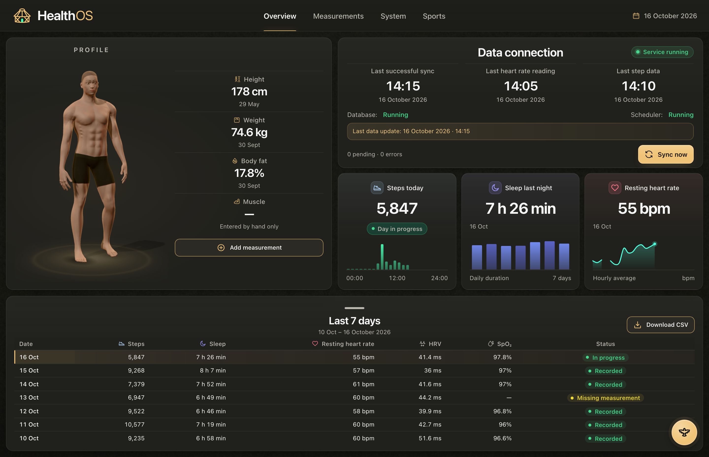
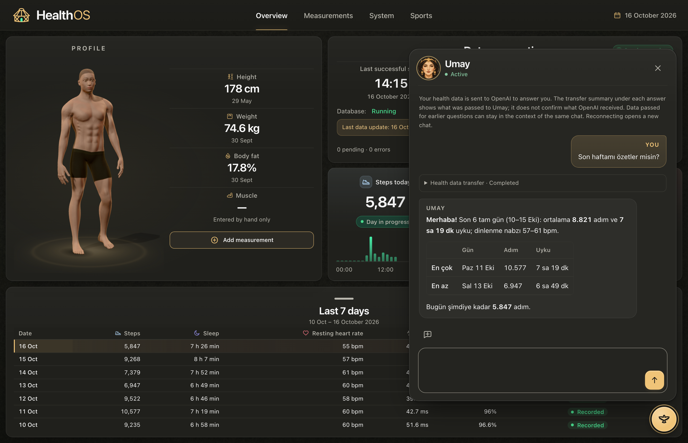
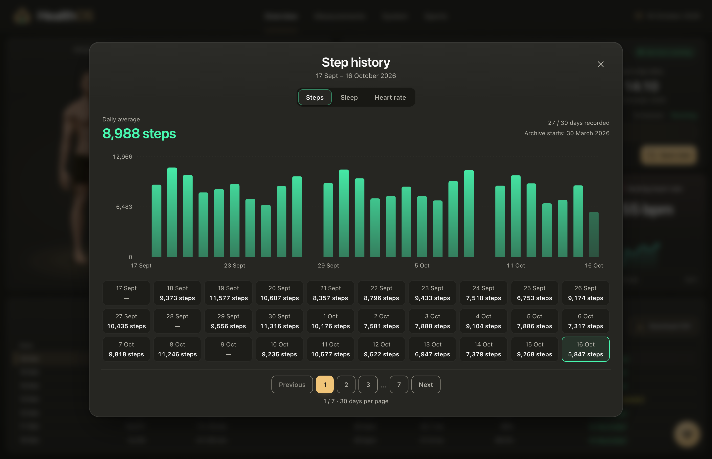
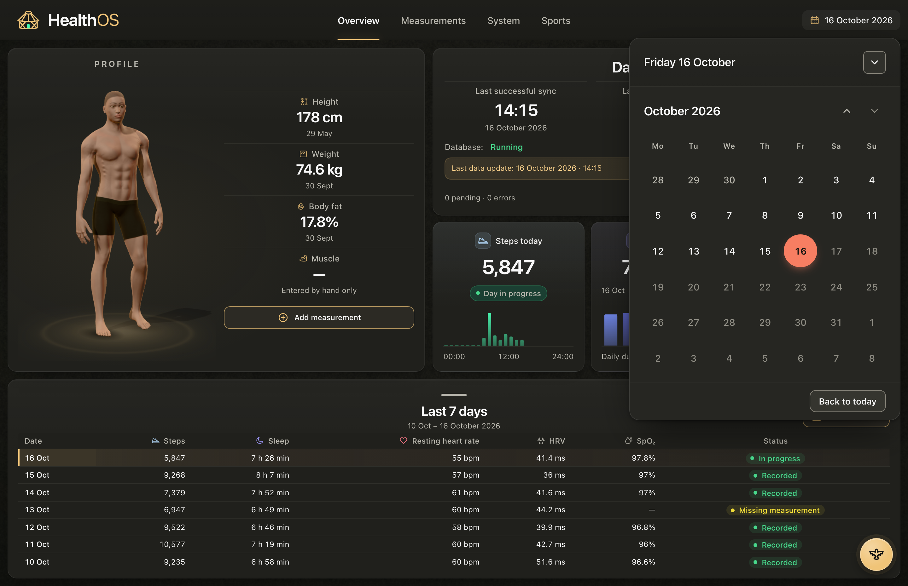
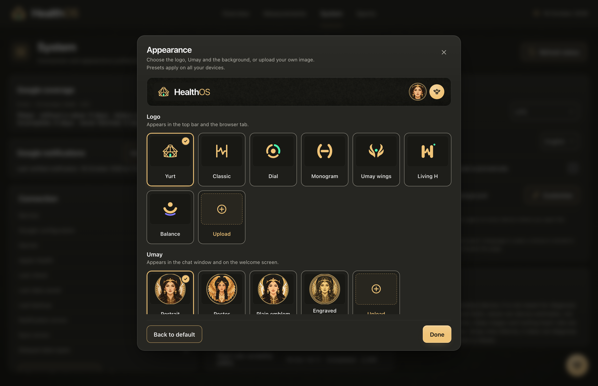
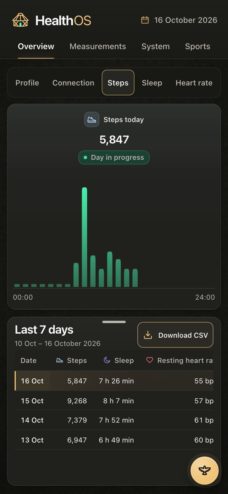
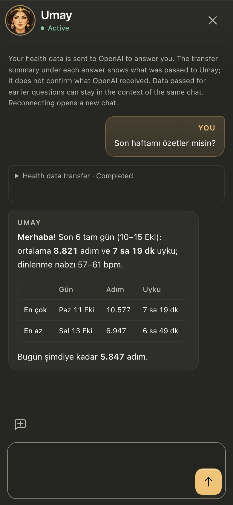

# Screenshots

The actual application interface, captured with the synthetic preview harness in
[`frontend/preview`](../frontend/preview/) (desktop 1440×900, mobile 390×844). No personal
health records are included; every value comes from `frontend/preview/fixtures.cjs`. The anatomical
model is a generic reference.

## Desktop

**Overview.** Profile, data connection, today's cards and the last seven days on one screen.

**Umay.** The optional chat bubble answers from your archive and shows a per-turn receipt of what
was sent.

**Metric history.** Steps, sleep and resting heart rate in 30-day pages; missing days stay empty.

**Date picker.** Open any earlier day from the header; the cards and the seven-day table follow it.

**Appearance.** Logo, Umay portrait and background presets, or your own image. Presets follow you
across devices; uploads stay in the browser.

## Mobile

&nbsp;

**Phone layout.** The dashboard and Umay at 390×844.
